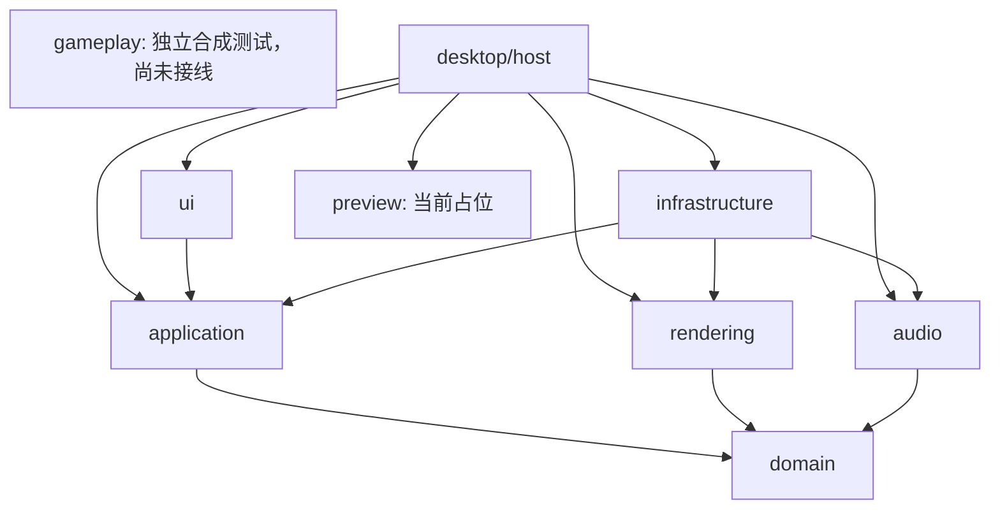

# 架构：当前实现与后续边界

2026-10-30，P2约定Windows范围收尾后的代码基线。本文以实际Cargo图和代码为准；详细对象／方法、源码位置及trait关系见[审阅包](review/README.md)。此前混合历次实验和计划的完整原文已[原样归档](archive/2026-10-30-pre-review/README.md)，原始证明JSON未改写。

2026-11-01需求更新：首版须持久化完整历史与分支，长期数据／偏好兼容先定约，见[数据兼容设计](DATA_COMPATIBILITY.md)。P3-0已完成[身份／文件定约](PROJECT_FORMAT_V1.md)和[独立原型验证](P3_0_REVIEW.md)，未接入正式保存；以下产品依赖图不变。

## 已实现的模块

2026-11-02的[P3-1C](P3_1_STORAGE_REVIEW.md)加入 application 定义的 ProjectArchive 端口、RestoreBuilder／RestoreCandidate 及 infrastructure 的 SqliteProjectFile。捕获端口升为2，存储端口1与API6分开；完整历史已可通过无窗口存储用例验证并恢复为新会话，普通编辑器尚未接文件入口。模块方向不变。

2026-11-03的[恢复补充](P3_1_RECOVERY_REVIEW.md)加入Windows原件只读独占冻结、独立副本热日志回滚和进程中断验证；返回已完整验证的新文件及恢复候选，不开放原位恢复或活动项目替换入口。

P3-0工具原型审阅修订2见[最新结果](P3_0_LOAD_REVIEW.md)：独立地址表／映射代次、只追加的Schema表示、同一读取事务内的流式完整校验。该存储器尚未接入产品。2026-11-02的[P3-1A](P3_1_STATE_REVIEW.md)已在infrastructure加入真实项目状态codec，以下项目内依赖图及唯一写入口保持不变。

仍采用单一Rust进程的模块化单体。2026-11-04的[K1-1增量](K1_1_SYNTHETIC_REVIEW.md)在根工作区增加独立gameplay，根共三包、桌面六包；gameplay尚未接入产品组装。

| 包／路径 | 当前职责 | 实际项目内直接依赖 |
| --- | --- | --- |
| domain · crates/domain | 不可变项目值、树、引用和不变量；不访问I/O／UI／设备 | 无 |
| application · crates/application | ProjectSession唯一活动写入者；Command、原子事务、草稿、历史、完整捕获／身份准入、查询及控制端口 | domain |
| gameplay · crates/gameplay | SyntheticTest-v1纯时间／输入／生命周期、事件、冻结／检查、候选／预算及三驱动；API7变长存储／分步校验与初始化／工作计数，Tiny4／Reference10000（G0／G1／A1及有限控制交错已测），只读帧／分页，无窗口及项目写权限 | 无 |
| audio · desktop/audio | SoundPlan、共享PCM配额、有界声音／混音与来源门控 | domain |
| rendering · desktop/rendering | Plan、CPU/GPU合成、像素／上传所有权 | domain |
| preview · desktop/preview | 当前仅占位PreviewState、场景与冻结／输入计数 | 无 |
| infrastructure · desktop/infrastructure | 字节／RGBA缓存、PNG／WAV、准备／供给／设备适配；项目状态codec、SQLite增量文件与完整验证 | application、audio、rendering |
| ui · desktop/ui | 面板、选择／手势、输入路由；定义窄Presenter | application |
| desktop · desktop/host | Editor组装、原生呈现／生命周期、线程及诊断入口 | application、audio、rendering、preview、infrastructure、ui |

外部直接依赖由[技术栈](TECH_STACK.md)及显式边界检查约束。以下箭头是当前静态依赖，不把运行时回执当作反向依赖：

`compatibility`和`automation`尚不是已实现包。真实玩法／定时／资源回退和AI传输仍是未来设计；引入时须更新实际依赖规则与负向回归。原先设计图中的preview→rendering／compatibility、application→compatibility不是当前已有边。

## 独立兼容内核：首个合成增量与后续边界

2026-11-03新增[独立stable兼容内核方案](STABLE_KERNEL_PLAN.md)与[新对话交接](HANDOFF_STABLE_KERNEL.md)。2026-11-04已按用户任务实现[K1-1合成小模型](K1_1_SYNTHETIC_REVIEW.md)：强类型绝对时间／来源、不可变预编译圆圈、原子输入接纳、有限工作量推进、完整截面投影及事件确认。所有结果仅标SyntheticTest，接受区间不重叠、最多4对象；桌面preview仍占位，不宣称stable兼容。

建议gameplay拥有规范化谱面、绝对时间／输入、对象生命周期和判定；compatibility依赖gameplay并提供无I/O的有证据格式／规则编译，preview依赖gameplay管理运行。infrastructure负责受限读取和设备适配，host注入application定义的窄控制／观察端口；application不直接依赖玩法运行时，渲染和声音不承担判定。完整未来依赖方向见专题，不把该设计写成当前Cargo图。

玩法状态可由其运行器修改，但没有项目写权限；模拟tick、歌曲位置、载入和成绩不进入项目Command／历史。皮肤热替换／历史检出更新只读材料来源，不重置对象或歌曲。模拟采用有符号绝对MapTime，与单调宿主时、音频生成／复制／消费锚点和GUI取样分开；现有u64占位计时及FrameSource不能冒充完整玩法协议。输入捕获／封口、时序精度和多实例绘制均须接线验证。

2026-11-05的[K1-2](K1_2_FREEZE_REVIEW.md)增加纯控制Freezing→Frozen及原位恢复：关闭后保留已接纳前缀并有界取消未来输入，完整截面才Frozen；恢复换InputEpoch并按槽重新武装，时间／判定／事件键保留，旧声音意图保持不可交接。运行源／观察协议为gameplay API2，合成profile仍为1；没有接入桌面preview或音频。

2026-11-05的[K1-3](K1_3_INSPECTION_REVIEW.md)增加已冻结同谱面的检查候选，按对象分步重建，取消保持旧运行，完整准备后显式激活新TransportEpoch及关闭的Q截面；跳过判定Unavailable／Inspection，不补Miss或声音。gameplay API3，统计来源随完整帧一起发布，未接桌面。

2026-11-05的[K1-4](K1_4_PREPARATION_REVIEW.md)增加SyntheticCoordinator，独占活动运行并统一创建／纯预编译载入验证／检查候选。调用者分步持有不可复制任务，键核对完整基准／操作／目标及独立代次；取消撤销资格，额度随真实所有者释放。标准库Box／Rc／私有Cell只管理运行、不可变内容共享和有界额度，无新依赖／线程。current只读，具名控制委托既有SyntheticRun，未暴露可变活动运行。gameplay API4、profile1及四对象上限保持。

2026-11-05的[K1-5](K1_5_DRIVER_REVIEW.md)增加显式驱动选择及有界自动输入准备。Manual／Automatic／Regression互斥，冻结截面切换InputEpoch；自动脉冲经共同输入／判定路径，恢复不补旧输入。同谱面检查候选捕获并继承所选驱动，创建／替换载入仍默认Manual。API5、profile1，固定进度及两输入计划纳入既有运行预留，无新依赖／线程／堆分配入口，未接产品。

2026-11-06的[K1-6A](K1_6A_STORAGE_REVIEW.md)保持固定四槽编译值，运行／检查共享Rc地图payload和来源额度；独立运行另核对自有来源容量。Observation改为固定摘要及FrameHeader，实时单项判定与借用式T处完整帧分开，有界分页核对完整来源／发布身份并原子写调用者缓冲。发布不再重建双份全谱对象帧，Pending／Failed保留旧完整截面，来源换代拒绝旧页。gameplay API6／profile1；未新增依赖或设备接线。

2026-11-06的[K1-6B](K1_6B_STORAGE_PROOF.md)在固定Rust1.95分配请求证明下采用私有有界缓冲，按N预留来源／运行／索引容量后再申请；归并比较／搬移及状态初始化均可分步。API7取消Copy地图，独立RunPreparation与统一候选共享同一玩法实现；局部工作计数和当前已请求payload另列，不充当进程成本。Reference开放10000，Tiny4；已测G0无输入及大图检查初始化，原四对象业务回归保持，无新依赖／线程或设备。

K1[整体退出审阅](K1_EXIT_REVIEW.md)已完成、暂不签收：适用纯核心功能及有界资源已有通过记录，KT23短调用固定批次补证尚缺。[D v2一致性修订](K1_6D_COST_REVIEW.md#2026-11-08一致性审阅记录)已备份推送2c387f2，本轮只改文档及复验证据。tools/gameplay-cost是独立诊断工作区，仅单向依赖gameplay和标准库；时钟／stdin/stdout在工具内，进程观察在Python父进程内，产品包不得导入工具。check_core检查其独立图、源码、格式／Clippy／测试／release及负向canary，不把时钟或OS访问引入核心。成本协议v2独立于API7／profile1：协议Valid、指标Unknown、产品NotEvaluated分开，阶段真实峰值不继承协议有效性。K2–K5未开始；原生接线、完整K1／KT及产品预算仍未验收，项目模型、application API和持久化格式不变。

## 对象、状态与所有权

`SkinProject`持有AssetLibrary、ElementDocument／LayerTree、ComponentTree、独立AudioComponent、SkinConfiguration及OutputMapping。原始Asset、图层实例和输出文件分离；同一素材可多处引用。构造／纯转换所得的脱离副本不等于活动项目写入口。

`ProjectSession`私有持有活动SkinProject、History、回执、身份准入、永久身份映射和原始字节固定租约。UI／导入／未来AI只能提交值请求；没有活动项目替换或可变引用接口。`ProjectDefinition`是验证用的自有定义值，未来加载只能在专用用例中受验证整体恢复。

持久LayerTree组在单个文档内嵌套；ComponentTree可跨文档组织独立输出边界。UI临时共同框只保存选择与派生几何，不自动创建组件。其变换仍生成逐目标的既有Command，并由一个草稿原子提交。

PreviewState、EditorUi选择／面板、监听音量、设备、Voice、缓存和线程不属于SkinProject。当前设置字段只是内存UI状态；本机设置存储、stable／Songs受限读取、完整游戏对象与统计尚未接入。

## 写入、草稿与历史

主链为UI动作→ProjectSession.submit／edit_draft／navigate→私有候选执行及模型校验→租约准备→一次发布。每条底层Command后校验，不允许靠下一条命令修复非法中间状态。失败／取消／NoChange不产生内容节点；回执保留语义另见[命令](COMMANDS.md)及[草稿](DRAFTS.md)。

一会话至多一个活动草稿。Replace始终从开始时的基础重建候选，Commit与普通提交共用发布路径；Busy隔离其他写入／导航。取消保留位不能因回执用尽而锁死。GUI已经连接拖动、参数、Esc／失焦／视口变化取消。

History保留父子、补丁和有界坐标；检出旧节点再编辑不删旧分支。NodeId为会话内非零u64，外部引用必须带HistorySessionId；n地址≤14、b坐标≤28字符，不随深度增长。Undo在分叉父节点记住刚离开的直接子分支，普通Redo优先返回该分支；没有有效记忆且多个后继时才报告歧义。显式Checkout重置导航记忆，不创建内容节点。

当前普通 GUI 没有历史持久化、同时多个活动分支工作区或完整树UI；独立存储适配已可恢复完整树。六类系统标签是显示／导航契约，保存标签必须由真实保存关联捕获节点。永久引用见[文件格式](PROJECT_FORMAT_V1.md)，不能把API6会话或私有Patch写成永久格式。回执寿命和素材导入语义仍见[决策清单](review/DECISIONS.md)。

## 状态编码与后续文件交接

infrastructure::project_format通过application::values只读查询SkinProject，并用显式schema 1映射生成小块／分页索引。serde与serde_json仅在infrastructure使用，domain不持有序列化derive或文件依赖。解码验证字节摘要、引用闭包、结构限额及领域不变量，返回脱离活动会话的SkinProject；没有替换ProjectSession的入口。详见[状态契约](PROJECT_STATE_SCHEMA.md)。

一个StateBundle只覆盖一个内容状态，媒体为原字节引用；required_originals列全已登记素材但不校验字节存在性或申请租约。完整捕获负责固定全部历史原字节，P3-1C的独立文件适配负责实际字节与全树验证；状态codec本身仍没有文件I/O。将来迁移追加表示，既有节点的原始状态摘要不被重新编码替换。

ProjectSession.capture_history捕获根与全部分支、永久身份、首次对象准入、导航和全历史原始租约。HistoryCapture仅保留共享不可变Patch和固定拓扑，不持有ProjectSession／ResourceStore；适配器通过有界poll得到验证后的完整SkinProject，私有Patch不成为文件协议。显式栈使每条边最多前后各走一次，状态验证／编码成本仍按状态总内容计量。

CaptureSnapshot及每个输出状态共享独立租约；成功、取消或失败不能提前回收消费者仍持有的资源。当前一会话只接纳一份在途捕获，最后所有者释放后才归还槽；命令／导航仍可继续。全部遍历结束才标is_complete，这不是文件保存成功。身份源由application定义、infrastructure用getrandom实现，首次接纳后永久映射保留，取消不改号；原始字节通过已有验证租约固定，不执行文件读取或解码。

完整文件交接现为：application 固定捕获 → infrastructure 编码／增量事务 → 文件回执；读取则在同一只读事务内验证完整文件 → application RestoreBuilder 校验全树、身份准入、导航及资源闭包 → RestoreCandidate → 通过专用工厂创建新 ProjectSession。工厂重建私有补丁而不重放旧 Command，不提供覆盖活动会话的 setter。GUI 保存回执、退出／自动保护调度、标签编辑仍待后续。

适配器持有文件句柄、SQLite 连接及有界元数据缓存；候选持有不可变完整状态与原字节租约。新会话独立固定资源，候选／文件释放不会提前回收历史仍需的原字节。新打开 epoch 由宿主提供，文件不恢复旧请求／草稿／Voice／GPU句柄。每个原始节点保留首写 action、状态引用与摘要；重新编码仅用于派生一致性比较，不重新绑定旧记录。具体对象和所有权见[P3-1C审阅](P3_1_STORAGE_REVIEW.md)。

显式 `SqliteProjectFile::recover_copy` 只把独立物理副本交给SQLite回滚；原件及日志在只读独占句柄下保留并复核摘要，目标须为不与源sidecar重合的新路径。全树／原字节验证通过后不覆盖发布；发布后不确定结果和清理残留单独报告。活跃来源Busy，未知日志／WAL／其他平台冻结未实现则拒绝；不通过剪枝或删除日志“修复”文件。恢复候选与普通完整加载共用校验及资源租约，未接GUI／自动调度，详见[恢复审阅](P3_1_RECOVERY_REVIEW.md)。

## 图像与GPU交接

显式路径→ImportWorker／Images准备原始字节→验证的StagedRaster及租约→Command登记Asset→添加图层。工作线程不持有ProjectSession，导入本身与字节准备分离；尚未增加在线下载器。

ProjectSession.request_preview经应用定义的PreviewPort向NativeHost提交只读项目与FrameSource。FrameSource包含会话、节点／修订、草稿、目标、尺寸／视口、场景和模拟时间；后台准备完成后仍须核对完整来源。历史／草稿／视口／设备变化拒绝迟到结果，不能只比较文件名或NodeId。

NativeHost／FrameWorker连接Plan、GpuComposer和Images，UI经Presenter绘制FrameKey。NativeHost创建GPU纹理、注册egui、保留待绘制／提交租约并等待真实完成后回收；UI不持有可变渲染器，FrameKey和TextureId都不是历史或资源所有权。当前普通呈现不做CPU回读；直接回读仅用于显式验证。

Plan共享文档变换、可见性和隔离图层组语义；导出仍未实现。隐藏子树只去掉贡献，整元素隐藏保留透明输出计划。X／Y在节点父空间：顶层普通层通常是文档像素，再经父／组件／视口映射到GUI点和设备像素，不能直接当作stable玩法坐标。拾取、变换框、拖动约束与游戏判定区必须分别建模。

当前1024²预览、32深度／65536操作等是P2能力／资源边界，不是stable格式规则；工作区512²是占位坐标。P3前须确认超限资源、导出画布和真实场景坐标的衔接，不能静默丢输出。

## 动画素材与输出计划（设计，尚未实现）

2026-11-03确认的[动画方案](ANIMATION_ASSETS.md)采用导入时识别多帧／保留原始逐帧时间，导出时按stable元素规则重采样。当前AssetKind／图层／schema1仍只有静态图片语义，没有GIF／APNG／WebP多帧或编号PNG序列关联，本轮不增加实现、依赖或版本。

原始动画来源与精确时长、可编辑播放配方／图层实例、派生输出计划分开。一个逻辑动画可被多个实例引用，帧不自动成为普通显隐图层；ElementDocument保留元素身份，未来OutputMapping须显式表达帧文件族。原件及全部分支依赖进入保存闭包，RGBA／GPU帧采用有界按需缓存，源格式的局部帧先正确合成为画布。

domain负责纯数据／不变量，application负责原子登记／编辑／捕获与窄控制端口，infrastructure负责受限解码／缓存／存储适配；未来compatibility提供有证据的命名／时基／循环规则，rendering在指定时间按共同计划合成，preview／desktop协调时钟与资源生命周期，UI／AI提交同一用例。此为职责预留，不改变上方当前静态依赖图。

素材原生预览保留源时序，stable兼容预览与导出共用目标计划。AnimationFramerate不是统一帧数上限，元素可有全局／固定／BPM／事件规则；未知时不声称兼容。固定正FPS分支默认原帧持有／选择并报告时间量化或丢帧，不自动补帧、改全局配置或取所有FPS最小公倍数。冻结时编辑仍刷新、恢复不补跑；热替换和迟到帧按完整来源及明确相位规则处理。

影响输出的时长覆盖／速度／循环／目标绑定和持久导出策略进入Command与历史，播放位置和缓存不进入。新增模型／内容schema／能力须显式演进，不能在schema1的分页sequence中塞动画字段或重写旧节点摘要。完整契约及全部待验AN01–AN16见[专题](ANIMATION_ASSETS.md)，本轮未运行动画功能测试。

## 音频、线程和资源

图片组件与音效组件独立；音效绑定一个素材，同一素材可复用。SoundPlan选择原字节透传、编辑或静音计划；未经编辑但不能解码的音频仍须保留。实际编码／文件输出属于后续P3，不把当前WAV试听限制等同导出格式限制。

application定义SkinAudioPort和AudioEditorPort；后者以supertrait复用前者，属于trait约束，不是类继承。宿主EditorAudio适配端口；AudioSupplyClient只将脱离的投影送给供给所有者，不把ProjectSession跨线程传递。

Windows普通Policy使用分离背景储备／Voice与CPAL原生输出，默认未启用设备；其他平台保留原路线但未验证。一个供给线程、一个PreparationWorker、至多四个待准备项、共享16份控制／回执额度和32声音上限有明确所有者。可选背景读取器只在接入背景来源时工作；普通GUI没有歌曲背景。音频持续供给不依赖GUI帧。

场景与显式试听分别门控。冻结停止背景／场景进度和游戏输入，允许编辑刷新及显式试听；恢复不补发旧事件。重绑定／隐藏／删除撤销旧试听而不自动播放新素材；同源增益保持已有试听位置并实时调整，取消恢复原增益。草稿内新触发声音、历史／停止／设备代次仍失效。背景定位／生成／回调复制锚点和设备消费位置不混用。

原始BlobStore跨媒体共用128 MiB／单份32 MiB；RGBA缓存80 MiB，PCM共享32 MiB／单份4 MiB。历史固定原始字节，不固定全部派生缓存；资源共用分配只计一次，真正释放后才归还预算。回调仅消费有界预分配数据，不分配、等待或释放最后PCM所有权。

普通图形故障冻结并诊断；完整窗口保留项目／历史、退休及重建仅在显式验证入口中实现。清理Pending保留所有者，Terminal拒绝新后端；运行时清理完成与Renderer／surface／Instance退休是独立门槛，不能提前释放或以复制项目代替保留原会话。

## 后续模块与审查门槛

P3已完成独立存储原型、真实内容状态codec、完整捕获、Rust文件适配及副本恢复基础；普通编辑器的正式保存／恢复接线尚待后续增量。项目格式、保存／打开／静态导出必须经application专用用例；保存捕获固定头及整棵历史、全部分支资源和保存／导航元数据。持久历史与新打开epoch分离，设置／本机状态／工作区／缓存各自保存；未知必要语义禁止覆写，迁移失败原件可用。外部谱面不成为皮肤Asset；在线准备在事务外，登记／引用原子提交。真实兼容规则集中在有证据的后续compatibility，不散入UI或domain。

同一工程文件须保存全部已登记内容，未使用库素材也不能省略。手动保存、历史自动与退出保护共用增量事务：适配器复用已有块，写入变化状态／新资源／索引页后原子提交代次；完整捕获不要求每轮重写／重新读取整份文件。手动检查点、最新保护检查点和活动头分开，普通打开选最近手动状态，允许显式恢复最新；不保存退出在application关闭门控下补存完成编辑但不推进手动位置，失败不默默退出。调度设计见[AUTOSAVE_POLICY](AUTOSAVE_POLICY.md)，参数仍待实施验证；Rust SQLite绑定和独立文件适配已实现，正式保存接线尚未完成，不能从UI另开只写树结构的旁路。

[自动保护调度方案](AUTOSAVE_POLICY.md)由未来application按有效变更／单调时间评估，desktop负责单次唤醒和有界存储任务；计时不依赖GUI帧／音频回调，后台不持有可变会话，不能新增通用事件总线或反向依赖。参数、捕获及暂存目标仍待实现验证，旧P2证据不覆盖保存器。

历史存储遵守只增不删：不可变节点／内容与可变标签、导航／保存指针、派生索引分开。用户／AI／后台均无删除或覆写节点的用例；标签经application专用元数据用例修改，系统保存标签仍依真实回执，不创建内容节点或改地址。每次提交保证目标既有历史完整且同ID内容不变，整理／迁移只改变无损承载；容量不足拒绝新增而非裁剪。完整文件可恢复已有标签／保存标记；标签编辑事务与产品保存接线尚未实现，不能将未支持修改静默丢弃。

当前跨模块边界检查通过并非未来永不出错的保证。新增公开接口／依赖／feature须同步规则、负向测试及文档；当前正式入口为check_core.py和check_desktop.py。详细审查覆盖、问题、文档分类及归档清单见[审阅入口](review/README.md)，阶段证据见[最终验收](P2_FINAL_ACCEPTANCE.md)。
