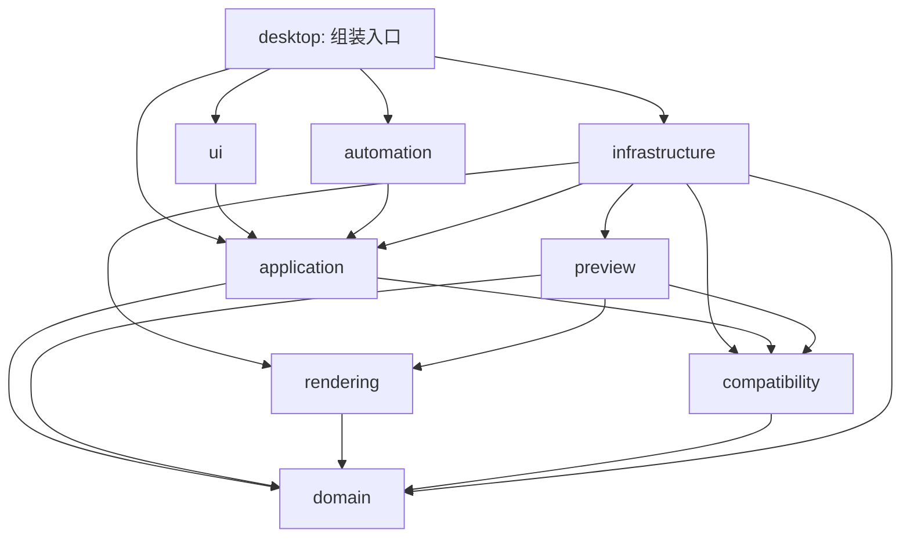
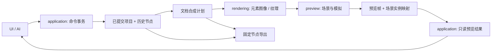

# 架构设计

状态：产品架构设计基线。2026-10-21 已完成 [P1-0／1／2](P1_PROGRESS.md) 的工作区、经校验模型、统一 Command／事务、修订冲突／去重及最小追加历史；撤销／检出／分叉、渲染与预览尚未实现。独立 P0 实验不属于正式模块，除进度中明确列出的内容外，本文中的模块名、类型名和调用仍为设计约定。技术方案见 [TECH_STACK.md](TECH_STACK.md)。

## 设计出发点

采用模块化单体：编辑核心、渲染、预览和桌面 UI 默认在一个进程中运行，以语言工程的包或模块限制依赖。只有真实外部客户端、AI 传输或已证明需要隔离的组件才跨进程；不提前拆微服务。

围绕三个独立状态建立边界：可保存的 SkinProject、可撤销分叉的 HistorySession，以及临时的 PreviewState / EditorState。操作历史是项目内容的版本树，不是游戏时间线，也不是鼠标与 UI 事件录像。

## 模块与依赖方向

下表描述静态代码依赖，箭头表示调用方依赖被调用方的公开契约。运行时通知可以向外返回，不意味着反向导入实现。

| 模块 | 职责 | 允许的项目内依赖 |
| --- | --- | --- |
| `domain` | 项目实体、值类型、引用关系、不变量和纯数据运算 | 无 |
| `rendering` | 文档合成计划、图层采样、CPU/GPU 渲染与派生缓存 | domain |
| `compatibility` | 有证据的 stable 元素描述、配置规则、格式映射与诊断 | domain |
| `preview` | 场景、游戏模拟、游戏输入、场景实例映射、能力契约 | domain、rendering、compatibility |
| `application` | 活动项目存储、命令、事务、历史、查询与用例编排；定义 I/O、预览和渲染任务端口 | domain；后续按实际用例允许 compatibility 的纯规则契约，不依赖 preview／rendering 运行时 |
| `infrastructure` | 资源／文件／编解码／平台实现；将 application 端口委托给实际预览与渲染实现的适配器 | application 的端口、domain、preview、rendering；需要时使用 compatibility |
| `ui` | 视图模型、工具、选择、控制柄、参数面板和输入路由 | application 的公开契约；UI 自己定义窄呈现端口，由 desktop 实现，不直接依赖预览／渲染器 |
| `automation` | 结构化请求校验、协议适配、结果序列化 | application 的公开契约及返回的只读值 |
| `desktop` | 入口与依赖组装、平台生命周期 | 上述公开入口 |



infrastructure 通过依赖倒置实现 application / preview 声明的端口，desktop 注入实例。application 不导入 infrastructure、preview／rendering 运行时或 GPU 类型；原图中的 application→preview／rendering 直接依赖在本次边界审查后改为应用端口＋适配器。preview 接收自身契约中的只读投影、渲染句柄和请求标签，不反向查询 application。适配器负责将应用修订／节点身份与运行时回执关联，preview 无需导入历史模块。

application 的实际用例包括：提交／取消草稿后请求新素材版本、历史检出后更新投影、AI 请求指定节点画面、场景切换与时间轴控制。它决定来源及控制语义，经端口发出请求；游戏逐帧更新和 GPU 资源寿命留在运行时宿主。提交项目与异步预览失败分别处理，后者不能回滚已经有效的项目事务。

UI 只获取 FrameDescriptor 的不透明 FrameKey、来源与状态；desktop 提供 UI 所定义的窄呈现端口完成 egui 原生纹理绘制。该通道不负责项目查询／修改，原生句柄不穿过 application 或 AI。详细的创建、尺寸变化、历史切换与回收契约见 [呈现交接](PRESENTATION_CONTRACT.md)。

先按逻辑模块限制公开面；不要求每个概念独立成包。首个语言工程必须提供可检查的包依赖或导入规则，禁止跨模块访问内部存储。无需为每个类创建一个接口，端口只用于真实边界或实现替换点。

当前实际工作区只含 `crates/domain` 与 `crates/application`，依赖为 application→domain；当前无第三方包，P0 工程明确排除。`tools/check_core.py` 通过实际 Cargo 元数据、保守源码规则、独立禁止依赖 canary 及编译拒绝测试检查边界，后续引入依赖／feature 必须显式扩展规则。查询值为副本，不提供可变会话引用；内容只经 submit 写入并同步记录历史。核心禁止 unsafe，工作区与工具链独立锁定。

## 核心模型与所有权

### 项目内容

| 对象 | 主要内容 | 不变量 |
| --- | --- | --- |
| SkinProject | ProjectId、SchemaVersion、AssetLibrary、文档集合、ComponentTree、SkinConfiguration、输出映射 | 不包含选择、历史树、窗口和游戏运行状态 |
| AssetLibrary | AssetId → 元数据与不可变 BlobRef；资源标签及组织信息 | AssetId 代表资源身份，内容摘要用于共享字节，文件名不是主键 |
| Asset | 类型、显示名称、尺寸/格式等已知元数据、BlobRef、导入来源说明 | 原始字节不就地覆写；外部来源路径只是信息 |
| ElementDocument | DocumentId、画布像素范围、LayerTree；语义绑定由 OutputMapping 关联 | 可独立编辑；stable 输出命名由单独映射决定 |
| LayerTree | 有序根列表；图层/组节点的稳定 ID、父子关系与本地参数 | 单父节点、无环、有序；根序列及组内序列共同确定绘制顺序 |
| ComponentTree／ComponentGroup | 跨元素的文档引用及可嵌套组件组，带自身变换和显式共同坐标映射 | 单父、无环；一个文档只有一条权威组件变换链，独立输出边界保留 |
| 图像图层 | AssetId、局部变换、透明度、显隐及支持的效果参数 | 共享 Asset 不共享图层参数 |
| 图层组 | 有序子节点及组变换、透明度、显隐 | 父子变换可组合，不允许迁移到自身后代 |
| SkinConfiguration | 原始语法表示与已识别的结构化值 | 未知键、注释及未解释条目可保留，已知配置的校验不破坏原文 |
| OutputMapping | 文档与目标元素/变体/导出文件的关联 | 输出冲突显式报错；元素、文档和路径不是同一 ID |

所有对象 ID 使用类型区分，例如 AssetId / LayerId / HistoryNodeId。具体生成算法在实现时选择；身份不随排序、重命名或历史检出变化。删除后新建对象不得复用旧 ID。

P1-1 实际采用非零 u128 项目／资源／文档／图层／组件／输出 ID；P1-2 已采用独立会话＋非零 u64 历史 ID，短地址待 P1-3。`ProjectDefinition` 是带 MODEL_VERSION 的分离输入，`SkinProject::from_definition` 只构造经校验的不可变值，不取得活动项目写权限。application 拥有活动 SkinProject，只创建空根、返回自有查询副本并经 Command 提交修改，不开放整体替换／加载捷径。MODEL_VERSION 是内存契约版本，项目文件 schema 在 P3 另行冻结。

图层与组件树使用平坦节点表、显式有序子 ID、派生父索引和世界变换；校验、遍历、克隆及释放不递归持有子对象。仅共用内部的关系校验函数，不建立公共通用树框架。BlobRef 只携带不可变摘要和字节长度，真实字节及摘要核对由后续字节存储端口负责；配置保留有序原始字节与可选字段范围，不冒充 skin.ini 解析器。输出路径目前只做词法、大小写及文件／目录前缀冲突检查，P3 仍须验证具体文件系统、保留名、Unicode 等价与安全发布。

画布坐标是编辑器自身的像素空间，UI 缩放、场景逻辑坐标、窗口 DPI 与输出倍率是四个不同变换。它们的转换在边界显式完成。不能把某个 stable 元素的锚点当成全局文档原点。

局部变换使用可组合的二维仿射表示，UI 先提供平移/缩放/旋转。组迁移默认令 `newLocal = inverse(newParentWorld) × oldWorld`，保持文档空间几何变换；新父组不可逆时拒绝。旋转与非等比缩放组合可能引入斜切，内部不得靠强行分解为平移/旋转/缩放而损失信息；参数面板遇到此类变换要明确表示或限制不支持的编辑。新父组的显隐、透明度等仍会影响合成像素。

首版只支持经过验证的基础合成操作。组透明度以合成组结果后再应用为设计语义，需要独立合成时按需分配中间纹理；不将组简单展平成多个带相同透明度的图层。额外混合模式、蒙版和效果必须同时定义预览/导出语义后再加入。

组本身可当作可编辑节点嵌套、选择并整体平移／缩放／旋转。文档内 LayerGroup 与跨元素 ComponentGroup 共用变换语义，但保留不同输出边界，见 [组件模型](COMPONENT_MODEL.md)。组件变换进入各成员的共同合成计划，不能仅改变游戏预览位置；跨文件隔离透明度／蒙版暂不继承单文档组能力。包围框、游戏命中区和 GUI 区域分别计算，空组与不可逆迁移均有明确处理。

### 会话与预览状态

- `ProjectSession`：拥有当前已提交内容、HistorySession、SessionRevision 及可选编辑事务。UI 和 AI 只获得只读投影。
- `HistorySession`：根、历史节点、当前节点和分支寻址；第一版仅驻留会话，不写入项目文件。
- `EditorState`：当前工具、文档/图层选择、视图变换、面板状态。属于 UI/编辑器会话，不作为项目内容保存。
- `PreviewState`：场景、游戏选择、模拟时间、音频游标、播放/暂停/游玩状态及测试设置，属于 preview。
- `UserPreferences`：本机玩家展示资料、预览运行偏好与默认皮肤来源；经 application 设置用例和 infrastructure 存储端口管理，preview 只收只读值。不属于 SkinProject、skin.ini 或项目历史，P1 暂不实现。
- `SceneInstance`：游戏中的一次绘制/交互实例，带自身身份并映射到 DocumentId / 元素语义。一个文档可能对应多个场景实例。
- `RenderedElement` / `ExportArtifact`：由项目内容派生的结果，不反向修改文档。

`SessionRevision` 在成功内容提交或活动节点切换时单调增加，不能直接使用历史深度作为修订。节点 ID 标识历史位置，内容摘要标识内容，渲染修订标识画面；三者分别使用。

## Command、事务与查询

公开契约先保持为少量服务：ProjectQueries、ProjectCommands、HistoryService、ProjectIO、PreviewControl。它们是职责分组，可以由同一个 application 门面暴露，不必构建复杂服务体系。

| 服务 | 示例能力 | 是否产生项目历史 |
| --- | --- | --- |
| ProjectQueries | 读取当前/指定节点项目、列举资源、文档和图层、检查引用 | 否 |
| ProjectCommands | 提交命令/原子批次，预校验，开始/更新/提交/取消编辑事务 | 成功内容提交时产生 |
| HistoryService | 列举节点、解析地址、撤销、重做、检出节点 | 不创建内容节点；检出改变活动状态 |
| ProjectIO | 新建、打开、保存选定节点、导入、导出 | 导入内容通过命令；保存/导出不产生；新建/打开建立新根 |
| PreviewControl | 查询能力、切场景、暂停/恢复、全屏、截图 | 否 |

P1-2 已实现 application v2 Rust 值契约，见 [命令契约](COMMANDS.md)。核心请求形状如下；尚无 JSON／AI 服务或稳定的跨进程编码：

```text
CommandRequest {
  api_version, session_id: HistorySessionId, request_id,
  expected: { head: NodeId, revision },
  commands: [ Command ]
}

CommandResult {
  status: committed | no_change | rejected,
  state: { head, revision }, changed_objects, configuration_changed
}
```

基础命令包括 RegisterAsset、RemoveAsset、CreateElementDocument、AddLayer、RemoveLayer、ReorderLayer、ReparentLayer、SetLayerTransform、SetLayerProperties、SetOutputMapping，以及配置节/条目的添加、删除和设值。命名可调整，但业务规则只能有一份。命令载荷使用可序列化值，不使用直接赋值路径、任意脚本或 UI 回调。

一次提交的处理顺序：

1. application 检查会话、请求去重、期望节点及修订；同一项目的写入串行执行。
2. 解析输入并验证候选对象 ID 的会话内准入，构造已解析命令；成功创建的身份不再复用。预校验不能代替提交时的再次校验。
3. 在隔离候选状态中按序执行整个批次，检查引用、图层树、配置及输出不变量，生成可逆变更集。
4. 验证全部成功并固定必要原始资源后原子发布内容、历史节点和新的修订，返回一次 Committed 结果；后续适配器据此刷新。失败不发布部分内容、历史或成功通知。
5. 渲染、面板和预览依据变更对象增量刷新。派生工作失败只形成诊断，不撤销已经有效提交的项目内容，也不冒充渲染成功。

文件解码、网络或 GPU 操作不放在可逆命令中。导入先将资源字节写入暂存区并验证，然后使用 RegisterAsset 原子登记；失败产生的无引用暂存数据可安全清理。历史重放使用已解析 ID、元数据和 BlobRef，不重新读取外部文件或再次生成随机 ID。

P1-2 的 ResourceStore／BlobLease 只固定已暂存且经存储适配器验证的内容，原图字节不进入项目补丁。预检不触碰端口；提交时新租约先私有获取，失败释放，历史可达租约在会话中保留。候选执行每条命令后重新验证模型，所有可失败步骤在发布前完成；同步 owner 不引入通用事件总线。去重回执含失败与 NoChange，且有明确数量上限，详见命令契约。

错误至少可区分 InvalidReference、WouldCreateCycle、AssetInUse、InvalidValue、Conflict、Busy、UnsupportedCapability、IoFailure 和 ResourceLimit；向调用方返回对象 ID 与可理解说明。会话内相同 requestId 和相同载荷返回原结果，载荷不同则拒绝，避免重复执行。

### 连续拖动与原子历史

连续交互由 application 的编辑事务管理：开始时绑定活动节点/修订，更新时执行同样的命令校验并替换暂存候选，渲染可以消费带 DraftRevision 的只读临时投影；鼠标释放时提交一个历史节点，Esc/取消则丢弃。

UI 不直接修改暂存项目。首版同一项目只允许一个活动编辑事务，其他内容写入与检出返回 Busy；只读历史查询仍可进行。保存/导出明确使用最后已提交节点，不能把未提交拖动偷偷写入文件。截图说明是否包含草稿。无实际内容差异时返回 no_change，不增加修订或节点。

## 操作历史树

每个非根节点包含：NodeId、ParentId、追加顺序确定的子节点列表、事务摘要、已解析正向/反向变更集及所需资源引用；时间和调用来源只作说明，不决定重放行为。

```text
n1 根
└─ n2 A
   ├─ n3 B  原方案，保留
   └─ n4 C  从 A 继续编辑的新方案
```

- 撤销进入父节点，重做进入明确选择的直接子节点；只有一个子节点时可以使用简写。任意跳转走检出。
- 新节点总是追加到当前节点，不覆盖其已有子树。首版没有合并，所以结构是树而非合并 DAG。
- 节点用会话内固定大小的 u64 ID，外部身份另带 HistorySessionId。短标识 `n`＋base36 最长 14 字符，预留的分支坐标最长 28 字符；不在每个节点复制完整祖先地址。父子关系、显示路径和稳定身份分离，UI 排序不得改地址，见 [寻址设计](HISTORY_ADDRESSING.md)。
- 首版采用根状态与可逆元数据补丁作为恢复设计，不为每个节点复制全部图片。检出可沿最近公共祖先撤回再应用；恢复在隔离状态中完成并一次发布，不能暴露中间节点画面。
- 检查点和结构共享是可测量的优化点，具体间隔由性能数据决定，不先写复杂持久化集合或历史数据库。
- 查询旧节点只物化只读状态，不改变活动头或选择。检出后失效的 UI 选择按 ID 清理，不把清理动作记成历史。
- 树引用的 BlobRef 为存活引用。当前节点删除 Asset 不代表可删除其字节，其他分支或被固定的导出快照仍可能使用它。
- 项目保存只保存指定节点内容及其资源，不序列化首版历史；新会话建立新根。历史丢失边界须在产品中说明。

“平行编辑”首版表现为分支间独立往返。未来多工作区可共享历史节点和不可变资源，但每个工作区需有独立活动头、修订和选择，不能共享一个全局 currentNode；此能力不提前实现。

## 渲染与预览的数据流



application 负责从项目生成只读投影，经其定义的端口请求合成与预览；适配器调用 rendering／preview 的公开接口。preview 根据兼容描述生成场景及实例／文档映射；编辑器选中实例后可选择文档、图层或组件节点。若场景位置由游戏控制，控制柄不能暗示能直接拖动游戏对象，编辑参数仍属于明确的文档／组件空间。

上图是逻辑数据流，不表示 application 搬运 GPU 像素或持有纹理。控制结果经 application 返回来源与 FrameKey；桌面呈现桥在共享 GPU 上下文中解析该标识并绘制，捕获另走直接回读任务。图层合成、最终场景纹理和 egui 登记有各自所有者，待提交绘制／GPU 完成及捕获租约结束后才允许退休资源复用。

图层合成语义在 rendering 内保持一致：文档尺寸、排序、局部/组变换、裁切、透明度、alpha 约定、色彩空间及采样方式均可测试。CPU 导出与 GPU 预览可以有不同执行后端，但使用相同合成计划和有容差的对照测试；不能维护两套互不验证的合成规则。

缓存键依据资源内容、文档/效果参数、合成器版本和输出尺寸/策略生成，不只使用 DocumentId 或文件路径。新分支、历史检出、输出倍率和配置变化都必须正确失效。PNG 等编码输出的字节不同不一定代表像素不同，测试分别检查语义与必要的格式属性。

### 设置、区域与自动输入边界

[预览设置设计](PREVIEW_SETTINGS.md)明确独立设置用例：UI／AI 调用 application 的设置或预览入口，平台存储与字节读取留在 infrastructure；不把用户头像、用户名、设备／路径和测试偏好登记为皮肤 Asset。原版设置页由编辑器设置界面替代，SkinConfiguration 的修改仍走项目 Command。

实际谱面通过用户配置的本机 stable／Songs 来源受限只读获取，按选中谱面读取必要媒体。来源设置和谱面选择属于本机偏好／PreviewState，音乐／谱面不自动登记到 SkinProject；解析与路径边界检查经 compatibility／infrastructure 接入 application 的专用用例，不依赖个人安装目录或真实资源完成核心测试。详见 [实际谱面设置](PREVIEW_SETTINGS.md#实际-stable-谱面与必要媒体)。

嵌入预览默认自动打图，提供开／关覆盖，独立于 Auto Mod；全屏按明确的测试设置解析有效输入来源。自动控制器由 preview 拥有，输入携带场景／时间代次，受冻结、定位、故障和就绪状态门控。不能通过 UI 伪造按键或修改 Mods 来实现默认策略，也不能把自动输入记入项目历史。

preview 按已验证规则输出图像／图层变换边界、拖动约束、GUI 判定区域及玩法辅助显示的只读描述，包含实例／文档映射、坐标空间及可用性；application 提供查询，UI 绘制覆盖层并路由输入。各区域不能互相替代，未来 mania 使用专用玩法描述，不把未知布局固化到 domain。控制柄只编辑文档参数，不能暗中拖动游戏位置。

默认素材解析由 compatibility 的已验证查找规则与 infrastructure 的显式资源来源共同实现；返回来源与诊断，区分透明、缺失和损坏。当前 stable 原版素材仅作用户本地指定的开发输入，不进入项目仓库、核心测试或发布包；未来内置默认皮肤须独立自制／授权。所有可皮肤组件是最终覆盖目标，在线业务省去后使用本地状态呈现其界面。

### 两类时间与独立失效机制

- `SimulationClock`：推进游戏动画、谱面时间与音频；暂停后逻辑时间保持常量。
- `EditorClock`：界面反馈、编辑控件和异步任务使用的真实时间，不用于推进游戏。
- `RenderInvalidation`：项目提交、草稿变化、纹理就绪、场景控制、视图变化等引发刷新，与模拟时间是否推进无关。

暂停的约束是“模拟不推进”，不是“整个程序停止渲染”。暂停后素材改变，合成器更新纹理，预览在相同模拟时间绘制新帧；无变化时不持续重画。游玩音频与模拟时钟需在后端内统一暂停，不能只把画面停住。

游戏输入只有在交互工具、适当焦点和允许的运行状态下进入 preview。编辑输入由 application 的命令入口处理；暂停期间到达的游戏输入直接丢弃，恢复时重置输入边沿与计时锚点。编辑器暂停/返回按钮走控制通道，不能被游戏输入冻结。

后端公开 PreviewCapabilities，例如 sceneSwitch、interaction、pauseSimulation、hotReloadWhilePaused、playtest、fullscreen、capture。首版只实现占位后端；后续添加兼容后端或真实外部测试适配器，但不预制插件加载系统。外部客户端缺少某项能力时返回 UnsupportedCapability，不伪装成功。

时间轴预留 absolute seek、小节／拍吸附与细调，见 [预览时间轴](PREVIEW_TRANSPORT.md)。时间定位、场景重建和统计准确重建是分别可查询的能力；经预览控制端口协调新代次、旧 PCM／自动输入作废及冻结确认，不改项目历史。跳转后分数／ACC／combo 的具体展示模式待讨论，来源与有效性必须可辨认。

预览器按皮肤编辑所需的最小本地能力实现，范围见 [精简功能边界](p0/PREVIEW_SCOPE.md)。必要场景允许注入明确的本地测试状态，省去账号、联机、商店与完整曲库等流程；素材、动画、声音及实际游玩所需行为仍按声明范围验收。外部 stable 是完整客户端对照样本，不作为待裁剪的产品依赖。

编辑器的“冻结模拟”与游戏内“打开暂停菜单”必须为不同控制操作。前者冻结所有游戏场景的逻辑动画和声音，后者是游戏场景的一种状态，可能仍有菜单动画或声音；不能借用普通游玩暂停就宣称满足冻结契约。未来若存在场景时间、音频时间、节拍或局部动画时间，均由 SimulationClock 派生或显式归类，不允许悄悄混用真实时间。

素材内容更新默认保留场景实例、动画相位和当前模拟时间，仅替换材质版本；不通过重建整个场景来完成日常刷新。改变动画帧集合或其时序配置时，按当前模拟时间和经过验证的规则重新求值，并报告不支持情况，不能未经定义地把动画复位到首帧。素材修订与场景实例生命周期分别管理。

### 异步工作与一致性

资源解码、缩略图、文档合成和导出在工作队列中执行，结果携带 NodeId、SessionRevision、DraftRevision（可选）和请求代次。较旧结果不能覆盖新画面；能取消的过期工作及时取消。

预览捕获结果附带来源节点、场景、模拟时间、纹理/渲染修订和完成状态。AI 请求新修订的画面时等待该修订完成或返回 pending/失败，不能返回无标识的旧截图。读取任意历史节点的预览不要求先切换活动编辑分支。

capture 由自有渲染器直接导出其渲染目标，不依赖操作系统窗口捕获。外部 stable 的图像对照使用 F12 本地图片或用户明确提供的文件，结合客户端、配置及 fixture 的身份记录；原始截图、登记信息和审查结果分别管理。

## 保存、导入与导出

建议首版项目采用目录：版本化 manifest、配置语法数据及按内容存储的原始资源；具体 schema 和扩展名在 P3 前冻结，不在本轮创建文件格式。图层与变换保存为参数，不保存合成图作为唯一来源。

保存顺序：固定目标节点 → 确认必要不可变资源已完整写入 → 写入临时 manifest → 校验 → 在支持的文件系统上完成替换。保留旧文件及失败可恢复信息；平台上的原子性与断电恢复须实测。缓存、临时文件及首版历史不计入项目内容。

打开顺序：读取版本 → 必要迁移 → 校验 schema/引用/资源 → 构造候选项目 → 整体建立新会话根。加载失败不能部分覆盖当前会话。恢复、迁移与新建是专用生命周期用例，不能暴露为任意项目替换接口供日常编辑绕过命令。

导出顺序：固定历史节点及资源引用 → 按兼容配置解析输出计划 → 校验冲突与不支持项 → 用共享合成器生成图像及 skin.ini/附件 → 写入暂存输出 → 校验完成后发布。导出清单标注节点及兼容范围，不需要写入皮肤项目内容。

首版优先导出到新的独立目录，不做危险的游戏安装目录覆盖。归档解包需限制路径、大小和文件数量；导出命名根据目标平台检查路径及大小写冲突。原始用户素材、第三方默认资源和生成文件分别管理。

## AI 与扩展边界

先保证 application 契约能够序列化并拥有稳定 ID、版本、预校验、结构化错误和冲突处理。将来的 automation 适配器只做协议、身份/会话校验和结果转换，不重写编辑规则。

AI 能查看指定历史状态、提交事务、检出节点和请求预览，但无核心对象写权限；不提供任意反射写字段或执行脚本的捷径。传输选择本地优先，不提前开放远程服务。内嵌聊天、模型账号、网络供应商配置和编辑核心分离。

不为尚不存在的扩展建立通用插件、依赖注入框架或跨语言 RPC。真实 stable 接入若必须为独立进程，先定义有限的预览能力协议，应用核心仍保持模块化单体。

## 当前决策记录

| ID | 状态 | 决策与理由 | 重审条件 |
| --- | --- | --- | --- |
| D01 | 已采纳 | 模块化单体、单向依赖，避免编辑器初期承担分布式复杂度 | 某组件有实际隔离或部署需求 |
| D02 | 已采纳 | application 独占项目写入；UI/AI 共用命令与事务 | 不因 UI 框架选择改变 |
| D03 | 已采纳 | 资源不可变共享，实例独立，输出派生 | 新资源类型加入时扩展语义 |
| D04 | 已采纳 | 会话内历史树、稳定节点 ID、旧分支保留；项目保存不含历史 | 有跨会话历史需求时独立设计迁移与资源回收 |
| D05 | 已采纳 | 模拟时钟与渲染失效分离，预览与选择分离 | 引入真实音频/游玩后补充同步细节 |
| D06 | 已采纳 | 兼容规则集中并附证据，不把未知规则硬编码 | 新证据或客户端差异出现 |
| D07 | 建议，待原型 | 根状态 + 可逆元数据补丁，按需检查点 | P1 测试和历史规模测量 |
| D08 | 建议，待原型 | 目录项目、版本化 manifest、共享合成计划、独立目录导出 | P3 保存/导出验证前 |
| D09 | 分层决定，2026-10-20 | Rust 1.95.0／2024 核心采纳；egui／eframe 0.37.0＋wgpu 30.0.1 为 P2 集成基线，独立兼容预览；生产低延迟音频待定，不引入 P1 | P2 出现关键宿主／预算缺口、P5 实时需求或跨平台失败时针对该适配层重审 |
| D10 | 已采纳 | 普通面板布局先行，不提前编写复杂停靠系统 | 可用性验证提出真实停靠需求 |
| D11 | 已采纳 | 用户提供的非开源旧 stable 源码仅作外部只读研究；主线为独立兼容实现，不将该源码裁剪或接入 | 用户提供明确的新授权条件时再研究其他路线 |
| D12 | 已采纳 | 编辑器冻结模拟与游戏暂停菜单分开；素材刷新不隐式重建场景或重置动画相位 | 动画/场景语义出现经验证的特例时显式补充 |
| D13 | 已采纳 | 独立预览器保留皮肤/离线测试所需能力，精简原版业务流程；不复制完整客户端产品系统 | 新增能力须有具体皮肤或游玩用例 |
| D14 | 已采纳 | 文件/日志 + 外部 F12 图片 + 自有渲染回读构成验证路径，取消系统窗口捕获依赖 | 增加其他证据渠道时不得削弱来源与版本记录 |
| D15 | P0 实验限定 | 原生音频 FFI 隔离于默认关闭的 Windows 适配包；纯状态机仅消费设备值快照，UI 工程继续禁止 unsafe | 正式后端选型、设备恢复和跨平台实测时重审；不自动沿用为产品后端 |
| D16 | 已确认，按最新安排更新 | 当前继续 Windows；Linux 实测暂缓，保留适配接口；macOS 待具备设备。延期平台不阻塞当前 P0／无窗口核心，但始终标为未验证 | 启动 Linux／macOS 发布支持前分别补构建、实机、输入、图形、音频和预算记录 |
| D17 | 已采纳，2026-10-20 | 首轮范围 v1：standard／No Mod，P2 占位编辑，首兼容增量 15 个静态文件；完整 standard 游玩包含滑条／spinner 等，按阶段验收 | 增加元素／配置／玩法前扩展范围与兼容证据，不改写已有通过范围 |
| D18 | 已采纳，2026-10-20 | [P0 决策收口](p0/P0_EXIT_REVIEW.md)允许进入 P1 无窗口核心；未测硬件、产品预算、兼容／游玩有明确后续门槛。P1 禁止依赖 P0 实验、UI／GPU／设备 | 新证据影响核心可行性时重审；对应功能未过门槛不得标支持 |
| D19 | 开发预算基线，待产品验证 | [预算 v1](p0/RESOURCE_BUDGET.md)保留原目标并新增私有提交／GPU／播放 CPU 警戒，不回填旧成绩；超预算不删历史或改素材／导出语义 | 正式集成、依赖／后端／平台变化或预算失败时复测并显式重审 |
| D20 | 已采纳边界，待 P2 实现 | application 通过自己定义的预览／渲染端口编排，不导入其运行时；desktop 组装适配器及独立 GPU 呈现桥 | P2 的实际端口、同设备呈现、回收与无窗口 fake 测试；不能仅以更新架构图验收 |
| D21 | 已采纳需求，待实现 | 组可嵌套与整体变换；跨元素组件保留独立输出与共享合成计划，不能静默使用不可导出的组效果 | P1 不变量、P2 交互与 P3/P4 多输出验证 |
| D22 | 已采纳寻址约束，待 P1-3 | 会话＋固定大小节点 ID；短地址有长度上限，不存完整祖先路径，分支索引成本可测 | 深历史、宽分叉、溢出、规范解析与成本测试 |
| D23 | 能力预留，统计策略待定 | 自动播放时间轴支持精细定位方向；时间／状态／统计恢复分开，lazer 只作设计参考 | 各玩法定时证据、音频／长物件恢复和跳转后统计产品决策 |

重大调整在这里记录问题、选择、后果和重审条件；只有决策规模明显增加时再拆分独立 ADR 文件。不能只更新文字而不调整相应依赖与测试。

设置、自动输入、区域与默认来源的补充决策（2026-10-20）见 [预览设置设计](PREVIEW_SETTINGS.md)。它们明确用户设置与项目数据的边界，并扩展最终组件覆盖目标，不提前实现 P1 的游戏逻辑或修改既有实测结论。Git 自动保存按用户最新授权与 AGENTS.md 执行，只创建通过检查的本地增量提交，不自动推送。

## 实现时的维护保障

文档是约束基线，不能单独保证未来代码符合边界。首次工程落地时同时实现无窗口测试入口、格式/静态检查、模块导入限制和 Windows／Linux 构建检查；Linux 实机按 D16 延期，构建检查缺少环境时明确记录待补条件，macOS 条件单列。未测试不代表支持；平台依赖不得渗入核心，基础行为进入代码时带对应测试。各阶段的验收清单见 [ROADMAP.md](ROADMAP.md)。

P0 的 PNG 负载、缓存与界面脚本保留在独立 `experiments` 工程，仅用于测量，不构成正式 domain/application。其只读 fixture 清单也不是产品项目格式。性能证据见 [标准负载记录](p0/STANDARD_LOAD.md)：CPU/GPU 缓存 payload 与进程/驱动计量分开，工作集通过不等于全部资源成本通过。正式工程仍须按上述模块、Command 和共享合成契约实现，不继承实验中同步加载或视图脚本的写入方式。

[资源对照](p0/RESOURCE_COMPARISON.md)验证了共享解码像素上传与关闭后的派生资源释放。它不改变“历史可达的原始字节不能回收”的规则；缓存、上传队列、renderer 与底层分配器的生命周期分别计量。MemoryUsage 仅是 P0 比较的可选后端提示，正式产品默认值尚未决定。

P0 的[后台加载实验](p0/ASYNC_LOADING.md)将元数据读取、PNG 解码与 UI 纹理提交分开，并验证代次失效与每帧上传限额。这些任务只生成只读派生投影，不获得项目写权限；任务取消不构成项目历史操作。实验素材 ID 对应不可变 fixture，正式缓存键必须表达内容修订，不能只以文件名或 UI 当前选择标识任务。

[加载调优实验](p0/LOADER_TUNING.md)将结果通知与刷新节奏分开，预取队列仍保持明确上限；在途结果、UI 暂持像素与缓存分别计量。CPU 优化同时比较工作量和等待时间，屏蔽上传／绘制只用于归因诊断，不进入正式预览行为或兼容规则。

[GPU 上传实验](p0/GPU_UPLOAD.md)将逻辑资源键与物理纹理槽分开。派生纹理可在尺寸／格式／采样语义相同、旧绑定不再被活动视图引用时复用；不得覆盖仍受保护的视图。空闲槽同样占缓存预算，清除逻辑绑定与关闭资源分别处理。该固定尺寸实验不是正式缓存接口，也不改变历史可达原始字节的生命周期。Rust 分配统计仅为可选诊断构建，不给 UI／预览增加项目写入权或全局项目状态。

[重复与分配寿命诊断](p0/ALLOCATION_ATTRIBUTION.md)进一步区分 API 对象释放、显存计数下降和进程提交页回收。派生缓存的逻辑字节上限不能充当总进程预算；释放后短期保留也不能直接判为资源仍受项目引用或持续泄漏。Windows Vulkan 的独立诊断仅在 tools 内使用公开平台 ABI，不将平台计量、图形层开关或实验的固定容量引入领域接口，也不据此新增通用分配器框架。

[完整流程寿命实验](p0/UPLOAD_LIFETIME.md)将 GPU 回执与逻辑任务取消分开；取消文档请求不能抹掉已提交物理工作的计量。合并通知与回执完成也分别处理，不以完成回调强制连续刷新。这些仅约束派生工作队列，不进入项目编辑历史。

[小型合成验证](p0/COMPOSITION.md)用不依赖 UI／GPU／文件系统的 CPU 计划编译器和两种执行器，验证仿射几何及隔离组透明度。计划只读借用已校验素材；平台入口负责 PNG 与 GPU 适配。当前 linear-light 色彩、边界吸附与采样策略属于显式 P0 实验语义，尚未验证 stable 兼容性，不作为领域模型中的隐藏常量，也未确定正式 compute 或离屏纹理后端。

[标准合成扩展](p0/COMPOSITION_SCALE.md)按文档限制活跃源字节，GPU 适配器复用只读计划的显式缓冲；CPU 计划仍不接触平台对象。GPU pass 时间戳、host 墙钟和总进程资源分别记录，不把缓冲上限当作总成本。[可取消拖动原型](p0/INTERACTION.md)以私有会话拥有者接收值命令，向 UI 返回草稿投影及已提交快照；它只验证边界与手势行为，不是正式 application 模块或项目／历史协议。

[连续编辑实验](p0/EDIT_COMPOSITION.md)已将同一手势投影接入共享合成计划：GPU 计划持有不可变素材集合，只更新受验证的操作缓冲；不同素材集合不能复用旧绑定。显示适配与导出缓冲分开，GPU 上处理背景及 alpha 后直接提供 UI 纹理，正常编辑不经过 CPU 像素往返。单队列有序提交的实验不代替正式任务修订、过期结果隔离或后台加载端口。

[输出流诊断](p0/AUDIO_DEVICE.md)先在 tools 验证公开 WASAPI ABI；后续[同进程联动](p0/TRANSPORT.md)以可选 Rust 平台包将设备时钟接入纯模拟／输入门控及既有 GPU 编辑实验。发出控制后立即关闭游戏输入，匹配设备确认后更新状态；过期确认、held／repeat 和故障不能重新打开输入或触发墙钟补跑。观察状态与编辑命令分离，不进入历史。它没有正式核心写入权，也没有实际游玩、设备恢复或跨平台音频后端。

联动接入审查发现旧后台队列输出预乘 UI 像素和展平组树，不能替代新合成器的 straight RGBA 与隔离组计划。两者差异已有像素回归；后续后台接入须显式保留组语义、原始像素和请求代次，并单独约束 GPU 准备成本。不得以复用队列为由改变导出／预览结果，当前同步合成路径也不能宣称继承旧加载器的上传限额。

后续[后台合成交接实验](p0/ASYNC_COMPOSITION.md)将元数据／原始 RGBA 读取移入单工作线程，使用最新请求槽和有背压的结果交接；保留隔离组。候选 GPU 计划在每帧原图写入限额内推进，上传与首帧合成收到完成回执后才成为活动视图。旧候选也须完成或被安全回收，过期请求不能替换当前画面。逻辑取消与工作线程空闲分开跟踪；取消后仍须接收并丢弃旧结果，避免阻塞发送者或依赖新用户输入才能回收。这是只读派生状态，不构成导入、项目恢复或历史操作。

[共享音频切换实验](p0/SWITCH_AUDIO.md)进一步把单一 Transport 的所有权放在预览会话，活动文档视图只借用；文档编辑拥有者独立，切换不创建／复位音频时钟或 held 状态。文件／GPU 请求代次不等于设备控制请求号，取消文档不自动暂停或重启播放。这些仍是 P0 组装与视图接口，没有给 preview 项目写入权。

长帧诊断将上一帧框架 CPU 与当前 App、候选准备和上传分开。可选的一次性 GPU worker 在同一设备上创建固定 pipeline，回传后按预览设备会话复用；不依赖文档或项目，不引入通用 shader 缓存。缓存及线程成本计入相应观察；创建失败不回退为 UI 同步编译，设备或 shader 变化时须重建会话。该 P0 选项不代表正式渲染后端定案。

P0 音频端口 `audio_output::Output` 只交换暂停请求、设备代次和微秒位置／故障值；纯 Transport 不导入系统时钟、WASAPI 或 UI。Windows 组装适配负责原生错误／格式诊断，专用设备线程负责旧流释放及新流打开，平台对象不进入预览命令或项目历史。显式恢复创建新代次，保持最后模拟位置，收到新流的暂停确认后建立位置锚点；旧流回执全部失效，恢复就绪前的播放请求保持暂停。后续显式播放才推进时钟，不清除 held 输入。Linux／macOS 未来可实现同一小端口，目前未实现其音频后端，未创建插件／跨语言框架。此协议仍为版本 `0.0.0` 实验内 API；正式接口在后端选型时重审与版本化。

每次交付说明实际改动、执行过的检查、未测试平台和已知限制。禁止通过直接赋值核心状态“修好界面”，禁止以真实客户端人工验证替代事务、历史、合成与文件读写的自动测试。

[PCM 实验](p0/AUDIO_PCM.md)将流替换端口收敛为显式代次与内容位置。恢复与定位共用该值请求，避免模拟时间连续而内容隐式从头播放；纯 Transport 只允许暂停时请求定位，确认前保持原位置，确认后才允许显式后退。播放头由设备位置提供，提交前沿独立计量；有界原生 PCM 写入仍隔离于平台文件。该实验不引入正式音频解码／混音框架，不为缺少设备的平台创建假后端。

[Windows 桌面验收](p0/WINDOWS_DESKTOP.md)将原生事件计数、人工观察与覆盖判断分开，使用显式的合成测试时钟，不充当音频后端回退。窗口组装负责受限 fixture 拖放和证据文件，UI 继续通过既有命令会话修改占位文档；输入文本、面板、缩放和全屏状态不进入项目历史。原生 DPI 与 UI 缩放分别记录，全屏请求与系统回执分别处理。两个普通面板候选仅用于验收，不确定正式布局或引入停靠框架。

P0 物理输入暴露普通按钮焦点被误当文本输入的问题。适配入口改为显式传入编辑键盘归属，并保留 IME 取消帧；不将所有 GUI 焦点等同于项目选择或文本输入。系统剪贴板使用框架正式 feature，无自写 FFI；平台依赖与锁变化见桌面记录，不能把旧配置预算直接当作新配置结论。

[文件与时间线实验](p0/MEDIA_TIMELINE.md)新增可选的字节解码适配和只读 fixture 对象模型。平台输出只收已验证样本，不导入文件系统、解码库或谱面；时间线只消费已确认内容位置，显式定位不补发跳过的事件，亦不写入编辑历史。既有三方法音频端口保持不变，设备重开前后复用不可变内容。整段短文件解码和显式 fixture 场景窗口只验证路线，不构成正式流式播放器、stable 判定或全量格式导入。正式分层与版本接口仍在选型后建立。

[按需 WAV 实验](p0/STREAMING_AUDIO.md)以调用方提供的 Read／Seek 源和固定 PCM 缓存验证长文件成本。帧位置、内容代次和调用方持有的块分别表达；定位清除内部旧缓存，失败不交付部分块。它没有后台线程或平台输出，不能把阻塞的文件读取直接接到实时回调；未来有界工作线程交接须保留代次和暂停语义。文件句柄与采样器属于实验组装，库不接触路径、项目或 UI，没有改变 Output 端口和正式模块依赖方向。

[后台解码与输出](p0/STREAM_OUTPUT.md)在实验组装层拥有单解码线程，媒体库不依赖输出，Windows 适配器只接收有代次／源帧身份的 PCM 值。固定池区分生产权与消费权，原生确认提交后才消费。流式暂停清空原生缓冲并保留逻辑锚点，作废软件队列和在途旧结果；预备块不自动播放。解码／设备代次与项目修订分开，欠载不回退墙钟。Output 三方法不变，文件工厂、队列和诊断屏障不进入项目 Command；其互斥区、I/O 取消与恢复精度仍属 P0 限制，正式实现时重审。

[长时组合实验](p0/COMBINED_SOAK.md)在桌面入口同时拥有独立的音频会话、文档请求和命令草稿，文档切换不替换音频。诊断可以取出有界轨迹交给入口增量归档，不能清除已发生的溢出；文件写入仍不进入 PCM 适配器或纯 Transport。关闭活动资源、框架／pipeline 保留和进程退出分别计量，不把池大小当作总进程预算，也不以诊断回读代替正常显示链路的测量。

[重复资源寿命实验](p0/RESOURCE_CYCLES.md)进一步区分文档切换与会话重建。实验入口拥有本轮设备、生产线程和 PCM 队列，先停止／释放设备，再关闭并加入生产线程，确认没有活动文档或未完成后台任务后才开下一轮；异常路径保留同样的释放顺序。图形设备／pipeline 会话复用不等于原图／音频内容仍受引用，原生驱动保留也不能用逻辑池计数代替。重新创建的是实验预览资源，没有引入项目恢复、历史清除或核心写入入口。

[压缩音频实验](p0/COMPRESSED_AUDIO.md)仅以默认关闭的 feature 增加 MP3／Ogg Vorbis 读取器；线程和受限文件工厂仍在组装层，平台包继续只收有代次／源帧身份的 PCM，不依赖解码器。WAV 保留既有严格通路，默认 GUI 不引入媒体库。前缀重读定位是可测的实验限制，不扩充通用音频框架；独立参考长度冲突不能经裁切变成通过。FFmpeg 仅作离线 fixture 生成／参考工具，不是构建、测试或运行时必需依赖，也不随产品分发。本轮未改变正式模块、项目写入权或 Output 三方法端口。

[后续 Ogg 验证](p0/VORBIS_TAIL_AND_SEEK.md)通过独立 libsndfile 和分页控制归因首轮参考尾部差异；Vorbis 在媒体适配内部使用准确定位、预滚及实际 PCM 包锚点，MP3 保留前缀路径。媒体库不引入系统时钟、取消闭包或设备依赖；工作线程、代次与提交边界不变。私有参考 DLL 仅由 tools 调用，不进入 Rust 或产品后端，便携核心回归使用冻结样本而不加载外部工具。未因此增加正式模块、跨语言核心或产品接口。

[MP3 取消交接](p0/MP3_CANCELLATION.md)将前缀定位拆成返回完成状态的有界推进步骤，媒体内部不接收线程控制或回调。组装层在步骤间检查值类型代次，丢弃过期流并归还 PCM 租约；最终提交仍执行原有代次校验。该实验限制前缀工作量，不承诺打断阻塞 I/O，也不将 MP3 总定位成本视为已优化。未增加正式服务、项目写入入口或依赖。

[压缩与图形组合](p0/COMPRESSED_COMBINED_SOAK.md)复用原只读合成、单解码 worker、PCM 值队列和 Transport，用同源 WAV／MP3／Ogg 固定负载核对组合成本。编码与完整参考校验在离线工具内进行，原生进程只按需读取压缩源，不加载参考 PCM 或编码器；格式标签和编译 feature 仅用于入口证据绑定，不扩充 Output 或项目 Command。预算、初始化／诊断峰值和稳定阶段分别记录，未确定的私有提交／GPU 上限保持开放。

[格式与设备变化实验](p0/AUDIO_ADAPTATION.md)在可选 Windows 输出内部请求 shared 引擎转换，媒体解码与 PCM 队列保持源格式／源帧，客户端格式和设备混音格式分别诊断；不把变换后的端点采样写回项目或源素材。默认端点变化／不可用或原生流失效关闭输入并冻结 Transport；旧原生流先释放，软件队列代次作废，显式重建以当前默认端点重新协商并确认暂停锚点，再等待显式播放。监控、转换及原生身份均留在平台线程；恢复失败不自动循环重试，平台设备 ID 不进入 Output、项目历史或 AI 命令。Output 三方法不变，正式后端仍需分别验证跨平台转换及设备通知策略。
