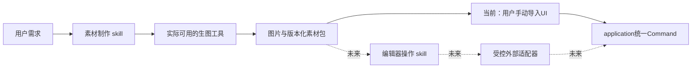

# 素材制作 skill 交接：先独立生图，再受控接入编辑器

交接日期：2026-11-03。本文件指导另一个新对话制作skill，**本轮没有创建、安装或运行该skill，也没有接入生图API或编辑器控制服务**。项目开发交接见[编辑器续作](HANDOFF_EDITOR_CONTINUATION.md)。下文的素材包和控制能力是待新对话细化、验证的建议，不能当作现有协议。

同日补充[动画素材设计](ANIMATION_ASSETS.md)：源帧时间、创作配方及stable重采样分开保管；当前编辑器仍不支持动图导入／播放／动画导出，本轮只补文档，未创建新格式字段或能力。

## 1. 用户意图与首批交付

用户希望接入Codex的重要目的，是利用GPT的生图能力制作osu!stable皮肤素材。应先做一个真正可用于生成、修改、保持风格一致和交付图片的skill；编辑器功能尚未完整，不必等待它完成才能产出素材。

建议分开两个职责，名称暂定：

| skill | 目标与阶段 |
| --- | --- |
| `osu-skin-assets` | 现在制作：理解视觉需求、调用可用生图工具、迭代、验证、展示并交付不可变版本的素材包 |
| `skin-editor` | 预留：发现编辑器能力、查询项目、准备导入、原子提交、草稿／历史／预览操作；真实控制后端未实现时不可声称可用 |

前者不直接打开项目数据库或调用UI内部方法；后者不负责生图模型、风格推理或PNG后期算法。独立生成素材是完整可交付模式；自动导入是将来的可选接线。

先交付一个范围明确的生成skill、所需最小参考／验证工具、素材包草案和可复核的试用结果。不要一开始实现在线商店、通用工作流引擎、完整MCP服务器或编辑器保存系统。

## 2. 先读哪些资料

1. 项目根[AGENTS.md](../AGENTS.md)、[架构](ARCHITECTURE.md)、[README](../README.md)与[最新开发交接](HANDOFF_EDITOR_CONTINUATION.md)。
2. 从当前会话的技能目录发现并读取`skill-creator`、`imagegen`及参考的`work-pets:create-pet`。参考快照为work-pets 0.1.6；缓存位置可能变化，不在新skill中硬编码个人绝对路径。
3. 宠物skill关联的`sprite-sheet-contract.md`用于理解基准图、逐项QA和交付验证；需要深入了解时再读对应脚本，不整批复制插件目录。
4. [组件模型](COMPONENT_MODEL.md)、[在线素材导入契约](ONLINE_ASSETS.md)、[预览交接](PRESENTATION_CONTRACT.md)、[输入约定](EDITOR_INPUT.md)、[待定决定](review/DECISIONS.md)。写控制契约时再读application源代码。

这里只是**研究宠物skill的方法**，不是调用创建宠物任务；不创建Pets Library、上传宠物、调用`create_pet`或安装其专属服务。

官方资料已在本轮核对：[构建skills](https://developers.openai.com/plugins/build/skills)、[Codex／ChatGPT技能说明](https://learn.chatgpt.com/docs/build-skills)。skill包含`SKILL.md`及按需的参考／脚本，描述负责路由，详细约定按需加载；skill不能凭空提供MCP工具或运行后端。具体安装／发现位置和可用工具仍以新对话实际环境为准。

## 3. 从宠物skill借鉴什么

| 借鉴 | 在皮肤素材中的用法 |
| --- | --- |
| 先固定canonical reference，再生成派生项 | 先建立用户认可的风格／调色板／线条／材质基准，后续同系列素材显式引用 |
| 输入角色分明 | 区分编辑目标、角色／风格参考、构图参考；修改已有素材时列出必须保留的部分 |
| 分任务生成、及时QA | 按独立元素或相关小组制作，完成一个先检查，避免一次生成整套后才发现风格或几何错误 |
| 艺术生成与确定性验证分离 | 生图工具负责视觉，解析／hash／尺寸／alpha／路径和布局检查由真实工具输出结果 |
| 验证最终确切字节 | 对最终PNG和素材包计算摘要；修改后重跑受影响验证，不拿旧报告给新文件背书 |
| 保留通过项、局部修复 | 失败只重做相关素材，保留原图、修订和报告；同类问题反复出现时换策略，不无限重试 |
| 身份与临时交付引用分离 | 包内ID／内容摘要、未来项目AssetId、模型任务ID和临时下载URL分别管理 |

**不照搬Pets规格。** 九种动作、十六方向、十一行图集、192×208单元、特定上传／Library流程都不是osu!规则。Pets对连接组件、空心／悬浮特效、发光或孔洞的限制也不能直接移植：空心圆、半透明光晕和粒子可能正是合法皮肤设计。不要复制未知授权的脚本、模板或内置美术。

## 4. 当前编辑器能做与不能做

已验证基线为私有仓库的`2719d0f`。有PNG路径／拖放导入、素材库／缩略图、加入元素、嵌套组、变换／透明度、临时共同选择和分叉历史。当前GUI的导入与加入元素可手动完成；项目登记是Command修改，当前仍会进入历史。

交接文档初版另已保存为`6e26e9d`，不代表代码增加动画能力。逐张导入PNG或某种动画PNG显示一张默认图，不等于自动组成／完整读取动画。

尚无对外MCP／CLI／HTTP项目控制、完整AI会话服务、正式保存／打开UI、真实皮肤导出或完整stable场景。Rust文件适配是内部基础，**不能作为skill写`.oskproj`的捷径**。

当前preview工作区／GPU尺寸、原字节预算和坐标都是实现约束，不是stable元素尺寸标准。默认原始字节总128MiB／单份32MiB，RGBA缓存80MiB、PCM32MiB；这些不授权把用户大图静默缩小或丢弃。生成文件超出当前可导入范围时保留原件并诊断；需要预览衍生件时单独标识、按授权处理。

没有控制接口时正常完成生成／QA／交付，结果明确为“已生成，未自动导入”；给用户现有GUI的导入步骤。不得靠写SQLite、改Rust源码、自动覆盖用户皮肤目录或模拟一串鼠标点击来伪装完成接入。

## 5. 生成流程与视觉约定

### 需求与生成

收集用途、风格参考、配色、尺寸／画布、中心／锚点、透明度需求、是否拆层或制作动画、需要保留的特征。能从用户现有要求推断的直接沿用；影响素材可用性的缺项再问。未知stable规范记录为候选，不自行补成已验证规则。

默认沿用实际运行环境的`imagegen`流程，优先内置生图／编辑工具；有本地编辑目标先按其规则看图。模型名、参数、保存位置、输出路径和引用图方式从实际工具文档获取，不编造返回文件。若只有显示结果但没有可读文件，先取得真实文件引用／导出能力，不能写一个虚构路径给验证器。

当前已读imagegen约定：内置工具不要求用户提供API key；CLI／API是另一路径，不能因内置不可用就静默切换、安装SDK或使用密钥。新对话再次核实可用工具；**编辑器未来嵌入Codex不等于自动获得同一生图工具、认证或额度**，产品后端接入另行验证。skill制作本身可先完成结构／脚本测试，缺真实生图时如实保留视觉验收未完成。

用少量代表素材建立风格基准，再依用户范围生成系列。保留每次请求／参考角色／结果及修订关联；不擅自扩大成整套皮肤、付费批量实验或无限候选。严格像素几何、文字和布局的处理方式要明确，不把程序占位图冒充GPT生成的美术。

### 分层与组件

- 可以交付单张合成图，也可以为同一元素输出对齐的底图、装饰、光效等独立透明PNG；共同画布和锚点须明确。
- 一张已合成的图片不能靠写manifest就声称恢复了可编辑分层。用户需要层时，应从生成计划上分别准备视觉部分，或明确只有扁平结果。
- 同一元素内的嵌套组与多个独立元素输出不同；例如hitcircle与overlay可以作为相关制作组，但仍有独立用途与输出边界。
- 包内逻辑分组不是当前项目的永久Component节点，也不自动改变成员层级；编辑器临时共同框属于选择状态。
- 当前支持能力之外的蒙版、混合效果／动画／PSD等不能静默忽略或烘焙成“仍可编辑”。保留来源，说明未支持范围和可选衍生结果。
- 图片与音效独立，首批图片skill不自动创建声音绑定；以后音频能力另立范围。

### QA分三层

| 层 | 检查内容与可支持的结论 |
| --- | --- |
| 文件／结构 | 实际可解码PNG、文件hash／长度、像素尺寸、数量、相对路径／重名、alpha存在与内容、规模限额；不能只检查扩展名或PNG签名 |
| 视觉 | 正常显示尺寸下的可读性、风格一致、中心／边距、裁切、光暗底上的边缘／半透明效果、无意外背景或参考标记；需要真实看图 |
| 游戏兼容 | 元素名、密度／缩放、动画、资源回退、真实场景；需有来源的兼容profile／回归或指定F12证据，文件合格不等于stable通过 |

要求透明时必须检查真实alpha，画着棋盘格的RGB图片不算透明。纯不透明图片也可能是正确需求；全透明素材只有在明确意图／规范下才接受，不能普遍视为缺失或普遍当作错误。

默认遵守当前imagegen的视觉编辑规则，不用自写Pillow替代应由生图工具完成的修图。确定性工具可做解码、统计、hash和预览验证；裁切、缩放、去背景、图集拆装等像素变换须有适用技能／用户授权，并保留原图和转换记录。优先原生透明输出，不机械套用Pets色键／去溢色，避免破坏光晕和半透明边缘。

多个相关素材使用共同坐标约定；不逐张把非透明包围框缩放至同样大小，从而破坏对齐。生成预览不推导GUI判定区域或玩法坐标。

动画素材先分清帧号／帧时长／锚点和已验证的目标协议，真实播放检查闪烁与跳变。首批静态skill可以明确不承诺动画，不需要复刻宠物状态机。

### 动画交付预留：原始时间与目标规则分开

按[动画专题](ANIMATION_ASSETS.md)保留单文件原件或全部帧PNG、显式顺序／条带布局、原始逐帧延时和时基／来源、画布／锚点及循环意图。AI输出静态帧图本身没有天然FPS；用户选择24FPS时标为创作设定，缺少时间就标待指定，不伪造源内嵌时间，也不只存平均FPS。可变时长要逐帧保留，原始声明与变速／时长覆盖分开。

编辑器未支持动画时，skill可以交付独立动画来源／序列及真实QA，但明确“未作为动画导入”。动图容器、精确帧拆装或动画生成工具是否可用须实际发现；静态条带不是已编码动画，模拟画面不是真实播放证据。解码或重采样不能静默丢帧、缩短时长或把首帧替代原件。

将来由编辑器按元素的已验证全局／固定／BPM／事件规则编译stable帧文件族；AnimationFramerate不是帧数上限，也不控制全部元素。skill不在生成／导入时自动修改全局配置。固定正FPS分支默认原帧持有／选择，报告时长量化或丢帧；-1的一秒模式等不能靠重复帧任意延长周期。原生预览与目标预览分开，后者须与导出共用计划，未知规则维持未验状态。

未来验收至少覆盖[AN01–AN16](ANIMATION_ASSETS.md)中与skill相关的来源时间、局部帧／对齐、时序修订、真实播放、目标损失和能力缺失。F12静态截图只证帧外观，不独立证明FPS；现有静态PNG／QA检查不覆盖动画。首批静态skill不因此必须立即实现完整动画创作时间轴。

## 6. 素材包契约：独立于工程格式

建议新对话定义一个小型、版本化的交付manifest，并写对应验证。以下是**字段职责草案**，不是已发布schema或当前编辑器可读取的文件：

| 部分 | 建议内容 |
| --- | --- |
| 包身份 | `schema_version`、包ID、素材家族／修订；与skill版本、application API和`.oskproj`版本分开 |
| 需求与来源 | 净化后的brief、参考角色／来源与使用说明；模型／工具信息仅记录真实返回／已知项，未知不猜 |
| 单个文件 | 包内entry ID、相对文件名、字节数、SHA-256、实际尺寸、透明度意图与检查结果 |
| 制作关系 | 用途候选、画布／锚点及单位、逻辑组／层顺序、原始与衍生关系；没有项目目标时不编造DocumentId／LayerId |
| 动画（待定扩展） | 完整来源／帧引用及顺序、逐帧时间／时基和嵌入／用户创作等来源、原始与覆盖配方、循环意图、目标规则／转换报告；缺时间明确待指定，不伪造FPS或当前编辑器支持 |
| 兼容声明 | 指定profile或`unverified`；已做／未做检查及证据引用，区分结构、视觉和客户端验证 |
| 验证／预览 | 报告、光暗底预览、相关素材对照；标明哪些结论来自工具，哪些来自实际视觉审阅 |

保留原生成字节及版本；不覆盖用户旧资产，输出名有明确修订。manifest中的文件引用限制在包根，拒绝绝对／越界路径和重复目标，按实际文件校验hash。旧schema不能理解时拒绝写回，不静默丢未知必要字段。

包内ID不等于项目AssetId；内容摘要不等于图层或历史身份。输入绝对路径、用户名、凭据、带签名URL、私人prompt等不写进可分享包／Git；必要本机映射留在独立设置或忽略目录。不要把生成追溯元数据塞进skin.ini或未经定义的项目标签。

一个可用包可以包含原始／最终PNG、简洁manifest、QA报告和预览；按实际需要组织，不为层次整齐创建空目录。它**不是`.oskproj`，也不是已验证`.osk`皮肤包**。普通Codex生图工作目录、ChatGPT Library或下载链接不是项目素材库的持久身份。

## 7. 为编辑器操作skill预留的窄契约

推荐关系如下，虚线都是未来接线：



生图后端和外部控制传输都在核心外。将来可以选择合适的本地MCP／CLI等窄适配器，但本轮不选定传输、不提前新增Rust运行包。换生图工具或控制传输不应要求重写素材制作流程、领域模型或文件格式。

建议预留的能力职责，**这些不是可直接调用的现有工具名**：

| 能力 | 契约重点 |
| --- | --- |
| 能力发现 | 真实服务身份、协议版本、支持动作／格式／限额；缺接口返回明确Unavailable／Unsupported，不能假装连接成功 |
| 项目查询 | 有界只读素材／文档／组／历史摘要、当前session／revision和目标；不导出可变项目指针或完整私人路径 |
| 资源准备 | 事务外校验字节／hash／PNG及预算，返回有作用域的准备凭据；真实worker／租约由适配器管理 |
| 计划验证／提交 | 显示目标及改动计划；登记／复用素材并加入目标层组时，通过application一个原子事务执行；返回实际对象映射、历史节点和结果 |
| 草稿／历史 | 经现有application能力处理预览编辑、取消、Undo／Redo／Checkout；不删除分支、不强行取消其他用户持有的草稿 |
| 预览观察 | 请求目标／来源版本明确的可读预览产物和准备状态；不把FrameKey／TextureId当图片或GPU所有权 |

现有源码可复用的语义入口是 [CommandRequest／ExpectedState](../crates/application/src/contract.rs)、[ProjectSession](../crates/application/src/lib.rs)、[草稿](../crates/application/src/draft_contract.rs)、[RasterImportPort／StagedRaster](../crates/application/src/preview_port.rs)。它们是Rust进程内API，**还没有JSON／MCP传输**。不要直接序列化Rust布局、抄UI局部ID分配器或开放私有execute。

现有RasterImportPort只处理静态PNG。未来能力发现须分别声明静态图／图片序列／动图容器、时间语义及目标动画输出；不能循环调用静态导入就声称完成动画登记。新增动画准备凭据／DTO与项目schema由编辑器增量显式演进，素材包版本保持独立；skill不自行写`.oskproj`字段或复用未声明的Opaque扩展绕过不支持。

控制契约须覆盖：

- session、基础head／revision、目标文档／组、独立请求命名空间、准备／运行代次。持久历史引用与打开epoch分开，64／128位整数不经JS浮点丢精度；当前API版本不能冒充未来wire协议。
- 准备期间用户编辑、取消、历史切换、关闭或目标删除后拒绝迟到结果；不得自动投放到新分支。Busy／Conflict明确呈现，重新选目标／确认修订后另发请求。
- 同一请求重试去重，有意再次投放与重试区分；同字节可共享，素材元数据身份不能只靠文件名合并。对象ID／请求回执的长期策略仍有[待定项](review/DECISIONS.md)，接线前须解决。
- 失败／取消／无效操作不留部分资源登记、图层或历史节点；暂存资源实际释放后才退还额度。成功后历史固定原字节，不能清掉旧版本以节省空间。
- 查询／生成／外部文件准备本身不创建内容节点；成功登记项目资源和修改层等经统一Command进入历史。
- 单目标导入计划可以在未接编辑器时生成，但`dry-run`不能冒充实际提交。fake控制回执／模拟截图必须明确标注，不能成为真实集成证据。
- 预览可在冻结模拟下反映编辑；返回结果须核对完整来源，不能拿旧节点画面或占位GUI证明stable场景成功。

公开接口尚未实现时，仅写短契约／fake验证或返回未接入；不要创建大批空方法、通用RPC框架或反向依赖。将来控制适配器由desktop注入，UI和AI仍共用application，不互相依赖。

## 8. 最小skill结构与验证路线

建议可审查源码先放仓库`skills/osu-skin-assets/`，仅包含有实际作用的`SKILL.md`、必要references及确有收益的验证脚本；`agents/openai.yaml`按当前skill-creator流程处理。该位置**只是源码建议，不意味着Codex自动发现或已经安装**。

当前仓库忽略且候选扫描保护`.agents`／`.codex`；不要为了安装skill解除这些整目录保护。安装／发布到实际发现位置另依当前环境及用户授权处理；不将个人缓存、密钥、生成工作目录或用户参考图带进Git。新对话若采用独立skill仓库，也不擅自设为公开。

`SKILL.md`保持简短：明确皮肤光栅素材生成／修订的触发、输入、流程与交付；复杂包schema、QA和未来编辑器桥接按需引用，不复制整份项目AGENTS或旧聊天。读取skill-creator并用其实际初始化／验证工具时先核对可用路径，不捏造脚本成功。

推荐实施顺序：

1. 盘点真实工具与输入，确定静态图片的首批边界；先设计短SKILL及素材包schema草案。
2. 完成一个独立透明素材和一组共享画布／锚点的相关素材流程，保留真实生图与QA证据；题材／规模沿用用户指令，缺生图时不伪造。
3. 需要脚本时验证真实解码、hash、alpha、路径与限额；加入损坏／缺失／重名／越界、旧schema、未授权覆盖等行为测试，不只检查文案或文件头。
4. 用未接编辑器的正常交付模式完成一次“生成→审阅→修订→交付→手动PNG导入说明”，不要求当前工程保存功能。
5. 为未来操作skill写最小能力／导入回执契约，以受控fake／门闩覆盖修订冲突、取消、迟到、Busy、去重和资源归还；说明是契约模拟，暂不改编辑器核心。
6. 运行skill-creator适用验证及新增脚本的真实测试；若改动产品代码，另外按项目核心／桌面检查。真实生图质量、手动导入和未来真实控制接线分别记录。

至少验收以下请求：单张透明素材；只改颜色保留几何的修订；同系列多素材风格／锚点；无编辑器时正常交付；缺生图工具时诚实降级到未验状态；未知stable规则不猜；模拟旧session／revision拒绝；文件合格但视觉失败时不报整体通过。

启用动画交付时增加：用户给定与源内嵌时长分辨、非均匀帧时长完整保留、缺帧／重名／无时间拒绝或待指定、原生与目标采样差异、原件不被重采样覆盖，以及编辑器能力缺失时独立交付但不报导入成功。结构schema检查、视觉／时序审阅和真实stable验证分别报告，不把本轮设计当作测试结果。

生成的用户素材／参考／运行报告默认放用户指定或忽略工作目录；只有来源明确、获准纳入版本库的自制测试资源进入Git。正式默认皮肤须自制或有分发授权，不能从stable默认资源、旧源码资源或用户私人皮肤复制。透明与缺失不等价的已有窄范围证据见[C03结果](p0/STABLE_C03_C08_RESULTS.md)，不据此泛化全部元素查找规则。

## 9. 并行工作与可粘贴开场

编辑器主对话负责P3存储／保存演进；skill对话先负责skill源码、素材包／QA契约及独立工作目录。使用同checkout时先核对其他对话的WIP，避免并发Git写入、全仓格式化或提交对方变更。Git仍按最新AGENTS和用户本轮指令，不因“制作skill”绕过敏感信息／来源检查。

```text
请在 E:\skin-editor 为我制作一个面向osu!stable皮肤图片素材的Codex skill。先读 AGENTS.md、docs/HANDOFF_SKIN_ASSET_SKILL.md 和当前Git状态，遵循最新版本管理规则，保留其他对话的修改。

请使用可用的skill-creator，参考当前安装的宠物create-pet及其共享contract的方法，但不要执行宠物创建／上传，也不要复制Pets的固定图集和美术限制。核心目标是使用GPT生图工具制作、修改并一致地交付皮肤素材；先完成编辑器尚未完整时也能独立工作的生成、QA、版本化素材包和手动导入流程。

架构上把素材制作与未来编辑器操作skill分开，预留小型能力／原子导入／历史／预览契约，缺真实接口时明确未接入；不得直接写.oskproj、绕过application、伪造项目回执或把fake当真实集成。本轮先不接正式保存／打开UI、不实现完整MCP服务或更改P3核心。

请同时读docs/ANIMATION_ASSETS.md：素材包预留原始帧顺序／精确时长／时基和来源，原始素材与创作配方及stable目标重采样分离。当前没有动画导入／序列导出，缺时间或目标规则时明确待指定／未验，不把逐张静态导入或默认图当动画成功；静态首批可以先独立完成，不自动增加完整动画编辑器。

先核实实际生图能力与用户需要的首批风格／素材范围，按已提供信息推进；工具或图像参数不明时查真实文档，不静默切换付费API。源码／验证工具和真实视觉验收分别交付，并说明仍未验证的stable规则与编辑器接线。
```
