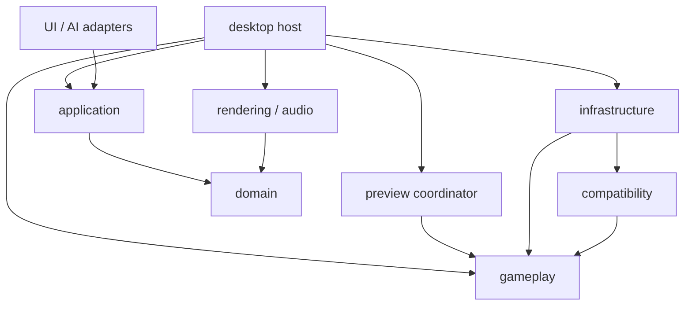

# 独立 stable 兼容内核：架构与分阶段计划

2026-11-09成本收口规格一致性审阅：上一轮8份文档已通过正常完整hook备份推送`bc6075737be8893735f896a5ef57aa5eec2f0e8a`，PRIVATE origin及远端SHA一致。[本轮文档修正](K1_COST_CLOSURE_SPEC.md#2026-11-09一致性审阅记录)补齐真实Tiny 4／2／4容量与专用调度、24类操作的阶段映射、补证建立的采样容量、逐样本回执、失败清理及冻结证据只读复核。32份准备样本的64MiB静态公式保持，1MiB容器准入和实际分辨能力待实现验证。本轮仅审阅／文档修正，无schema3实现、无新成本轮；Reference10000／Tiny4、API7／profile1和现有schema2保持，KT23／K1、产品性能及stable兼容结论均不升级。修订未提交；下一步先备份，再按用户明确任务推进，不自动进入功能开发。下方旧记录保留原时点。

2026-11-09成本收口规格：K1整体退出审阅9文件已通过正常完整hook备份推送`921547f8462d93e4cfef7531c11b756f1932406b`，私有origin及远端SHA一致。[成本补证开工规格](K1_COST_CLOSURE_SPEC.md)已细化6类固定批次、32份实际准备后取消样本的单池／64MiB聚合准入、Unknown边界和受测二进制独立冻结。schema3／CostClosure-v1仍是待一致性审阅的拟实施契约，现有工具仍schema2；本轮只改文档，不开发／重测。Reference10000／Tiny4、API7／profile1和产品预算保持，KT23／K1仍未签收。本轮规格未提交，下一步先备份并审阅规格，再按明确任务实施最小增量；不接GUI／原生设备，不宣称产品性能或stable兼容达标。下方旧记录保留原时点。

2026-11-08最新K1整体退出审阅：K1-6D v2修订已通过正常完整hook备份推送`2c387f2f57641e893d8dd12c3c363a75d4799995`，私有origin及远端SHA一致。[整体退出核对](K1_EXIT_REVIEW.md)已完成：已声明功能与有界受管资源的适用纯核心项已有通过证据；KT23仍缺未分辨短调用的固定批次补证与对应关系，K1暂不整体签收。独立新轮12进程协议Valid，受测二进制已单独冻结；Unknown和产品NotEvaluated保持，不与旧轮混合。本轮只改文档、复验证据，API7／profile1、Reference10000／Tiny4及运行逻辑保持；文档未提交。下一步先备份本轮审阅，再细化成本收口补证规格，不自动开始K2／GUI／原生设备或声明性能／stable兼容达标。下方旧记录保留各自时点。

2026-11-08最新D一致性审阅：初版20文件已通过正常完整hook备份推送`4994d2e73989b76ae727cb83dbc08ec943502e6e`，私有origin及远端SHA核对一致。[本轮修订](K1_6D_COST_REVIEW.md#2026-11-08一致性审阅记录)补10项Python回归，修复构建冻结、结束／阶段协议、异常记录保留、计量及资源边界，成本输出升为v2；453项Python／169项gameplay／6项工具Rust、正式核心和桌面架构检查通过。v2新测12进程协议Valid，209个调用序列、96个CPU窗口和全部108个阶段真实峰值仍Unknown，产品NotEvaluated。Reference10000／Tiny4、API7／profile1及运行逻辑保持。本轮修订未提交，下一步先备份，再核对K1整体退出条件及Unknown的影响；不自动进入K2／GUI／原生设备，不宣称性能或stable兼容达标。下方旧记录保留各自时点。

**2026-11-07最新D增量：** C一致性修订已备份推送`13fb466`，本轮无新可审查差异而复用该回退点。[K1-6D工具与首组成本基线](K1_6D_COST_REVIEW.md)新增独立tool→gameplay诊断工作区及只观察自有子进程的Windows采集，G0／G1／A1×1／256×两进程共12轮协议／黄金／资源校验Valid。443项Python、169项gameplay、6项工具Rust及正式核心、桌面架构检查通过。短调用与短CPU窗口仍Unknown，不代表产品预算；运行时、API7／profile1及容量保持。本轮新增量未提交，下一步独立审阅D后再做K1整体退出核对，不接GUI／设备或宣称stable兼容。下方旧记录保留原时点。

**2026-11-07最新C一致性审阅：** C初版13文件已通过正常完整hook备份推送`09075738`，PRIVATE origin及远端SHA一致。[本次审阅](K1_6C_SCALE_REVIEW.md#2026-11-07一致性审阅记录)修正两处测试条件，补2项规模回归与固定轨迹／故障断言；425项Python／169项gameplay及正式核心、桌面架构检查通过，未发现需修改运行逻辑的偏差。API7／profile1、Reference10000／Tiny4与预算保持。本次修订未提交，D实际成本及GUI／设备未开始，不宣称完整K1／KS／KT或stable兼容。下方旧记录保留原时点。

**2026-11-06最新审阅：** K1-6B初版32文件已通过正常完整hook备份推送为`747222c8`，PRIVATE origin及远端SHA一致。[B一致性审阅](K1_6B_STORAGE_PROOF.md#2026-11-06一致性审阅记录)修复激活计数回执丢失、无效起点多记分配及旧控制污染摘要计数，补7项回归；容量证明对应固定Rust commit，Reference10000／Tiny4、API7／profile1及布局保持。正式核心通过425项Python及156项gameplay，含G0两档预算；桌面架构检查通过。本次修订未提交，C完整输入／实际自动规模轨迹及D实际成本仍待明确后续任务，不接GUI／设备、不宣称完整K1／KT或stable兼容。下方旧状态保留其原时点。

**2026-11-06最新一致性审阅：** K1-6A初版28文件已通过完整hook备份推送为`c447a2a`，远端SHA一致。[A步审阅](K1_6A_STORAGE_REVIEW.md#2026-11-06一致性审阅记录)补5项来源寿命、同刻迁移及Pending／Failed旧完整帧／页回归，共137项gameplay通过，未发现需修改运行逻辑的偏差。API6／profile1、四对象及默认池保持；正式核心和桌面架构检查通过。本轮测试／说明修订尚未提交，B–D及完整K1／KT仍待验；不测成本、不接GUI／设备、不宣称stable兼容。下方早期状态按当时时点保留。

**2026-11-05最新规格审阅：** K1-6初稿7文件已通过正常完整hook备份并推送为`ffe2361`，远端SHA一致。本轮对照K0-A及现有实现完成[K1-6规格补充](K1_6_SCALE_SPEC.md#2026-11-05规格审阅记录)：全入口容量／共享池、四槽起步方案、实时账本与完整帧／分页身份、原始工作计数及资源／计量有效性。仅修文档，未开始开发或测量；当前仍为API5／profile1、4对象、116项gameplay基线，变长容量须先取得证明。

**2026-11-05最新一致性审阅：** [K1-5审阅](K1_5_DRIVER_REVIEW.md#2026-11-05自动输入一致性审阅)在初版备份`0a52f85`后补5项公开交错回归及1项故障单测，共116项gameplay测试通过。较远封口下的部分推进冻结、背压、四槽重新武装、旧候选／旧输入及故障门控未暴露已声明四对象切片的实现偏差；生产运行逻辑、API5／profile1及默认容量保持。仍未接GUI／原生设备，不扩展功能或宣称完整K1／KT、stable兼容通过。

**2026-11-05最新实现状态：** [K1-5自动输入／驱动互斥](K1_5_DRIVER_REVIEW.md)实现四对象手动／自动／回归互斥、冻结截面切换、有界自动输入准备、共同判定及恢复不补旧输入；gameplay API5、profile1，共110项测试通过。自动输入须先交接再封口，背压不丢半个脉冲；检查继承驱动，创建／替换载入默认Manual。仍未接GUI／设备，10000对象、实际资源成本及完整K1／KT继续待验，不宣称stable兼容。下方较早记录按当时状态保留。

**2026-11-05最新一致性审阅：** K1-4初版已备份并推送为`4d4ee9b`，本轮对照K0-A补6项公开生命周期／交错回归及两池溢出覆盖，共94项gameplay测试通过。逐步取消／关闭、迟到工作、失败及已激活任务延迟释放、满额取消和完整基准核对未暴露已声明四对象切片的实现偏差；运行实现、API4／profile1及默认限额不变，详见[审阅](K1_4_PREPARATION_REVIEW.md#2026-11-05统一候选一致性审阅)。未扩大功能、自动驱动、原生设备或stable兼容范围；完整K1／KT与实际资源计量继续待验。

**2026-11-05最新实现状态：** [K1-4统一候选准备／激活](K1_4_PREPARATION_REVIEW.md)在四对象SyntheticTest内统一创建、纯载入验证和检查的有效候选槽，核对完整基准／操作／目标／独立代次；两池分配前预留，取消资格与真实所有权释放分离。gameplay API4、profile1，88项测试通过。新入口不暴露可变活动运行，无新依赖／线程；自动驱动、10000对象及实际资源成本仍待实施，不表示完整K1／KT或stable兼容通过。下方较早实现状态按各自时点保留。

**2026-11-05最新实现状态：** [K1-3同谱面检查定位及一致性审阅](K1_3_INSPECTION_REVIEW.md)覆盖已冻结运行的有界检查候选、取消／旧请求拒绝及新TransportEpoch完整激活；gameplay API3，四对象／profile1保持。跳过对象明确Unavailable／Inspection，无假Miss或补发声音；新增5项边界／交错回归后共64项gameplay测试通过，审阅未改运行实现。统一准备／载入候选、自动驱动及规模计量仍待实施，不表示完整K1或任何完整KT通过。下方较早实现状态按各自时点保留。

**2026-11-05后续实现状态：** [K1-2冻结／恢复与输入重新武装](K1_2_FREEZE_REVIEW.md)已在纯SyntheticTest中落地；gameplay API2，profile仍为1，最多4对象，不接GUI或设备。Freezing只在有效封口及完整前缀结算后成为Frozen，恢复保留时间／判定并换InputEpoch，旧声音意图不重发。K1的检查定位、自动驱动／候选协调及规模计量仍待实施；无完整KT或stable兼容通过声明。

**2026-11-04实现状态更新：** 用户已明确授权按K0-A开始首个最小增量，[K1-1合成圆圈模型](K1_1_SYNTHETIC_REVIEW.md)已加入独立gameplay包。只支持最多4个不重叠接受区间的预编译SyntheticTest圆圈及纯核心回归，未接GUI／原生设备，也未开放兼容profile。K1剩余项、K2–K5及完整KT验收仍待完成；下方历次“本轮仅文档／全部待实施”是实现前的记录。

2026-11-03，供审阅的设计稿。**本轮不实现功能，不新增crate、接口、线程、依赖或文件字段。K1–K5及KT验收全部待实施。** “独立”指可脱离编辑器、窗口与设备测试和使用的Rust模块；产品仍是模块化单体、同一进程，不另起游戏服务或第二套客户端。

2026-11-04审阅补充：细化C1输入封口、C2有界推进／事件发布、C3音效提交／回执和K0分层准入要求。这些是待实现、待验证的执行契约；没有新增公共API、fixture或测试结果，也不表示K0准入已通过。是否启动功能开发仍由用户后续任务决定。

同日后续文档增量：[K0-A开工规格](STABLE_KERNEL_K0_A.md)进一步给出SyntheticTest值约束、Reference／Tiny有限配置、S01–S04操作与预期、继续／取消及剩余验收。它是待审阅的文档规格，不新增功能或KT通过记录，K0-B的兼容证据仍独立准备。

同日规格自审已在K0-A页补齐初始／检查截面、批次完整载荷核对、入口与消费按住态分离、重新武装、分步准备预算及错误分类，并固定KT23规模负载。这里只完成文档问题修订，不记录用户确认或功能验收通过。

## 1. 目标、现状与首批边界

目标是独立实现已声明范围的stable行为，支撑皮肤编辑中的冻结检查、实时改图／改声音、自动演示和实际离线测试。不能裁剪或移植无复用授权的旧stable源码，也不能把lazer或自定义模拟器的结果直接认作stable事实。

现有[preview](../desktop/preview/src/lib.rs)只有占位场景、无符号微秒计时、单次增量上限和输入计数；没有谱面对象、判定或成绩。现有PNG／图层合成、WAV试听、分离声音／背景供给、资源租约与GUI输入隔离可复用，但普通GUI尚无真实歌曲背景。P0压缩音频实验不是产品解码能力，[P2验收](P2_FINAL_ACCEPTANCE.md)也不是玩法同步证明。

| 首批内容 | 明确范围 |
| --- | --- |
| 玩法／规则 | osu!standard、No Mod；编辑器自动输入独立于Auto Mod，只存在一个有效输入驱动 |
| 谱面 | 先支持已验证的.osu v14／Mode 0子集、纯圆圈、无堆叠及目标选择歧义的受测布局；属性／定时及样本组合按profile逐项开放 |
| 模拟 | 带来源的规范化谱面、时间戳输入、圆圈出现／接近／判定／消退、一次性事件、暂停及检查定位 |
| 编辑器接线 | 首批15张静态元素的材料映射、编辑／交互隔离、自动演示、可关闭自动后的圆圈手动测试 |
| 音乐／音效 | 首轮自动验收用自制PCM16 WAV；用户选定资源在当前可处理的格式／设备组合内另测。其他编码明确未支持，不丢原件、不冒充已播放 |
| 统计 | 真实圆圈判定记录与计数；从头／区段／检查／样例来源可辨。完整stable分数、血量、失败和跳转后的HUD默认方案不在此稿中擅自定案 |
| 暂不覆盖 | slider、spinner、其他玩法／Mods、堆叠与未验证notelock组合、完整HUD／结果、故事板／视频、完整资源回退与动画素材、任意真实谱面的完整游玩 |

这不是“全部圆圈谱面已兼容”，更不是完整standard。首批准入检查须有明确可测试的条件；无法证明属于支持子集时拒绝运行并列出原因，不能过滤掉未支持对象或改变时间后继续宣称原谱面已被测试。已识别但本切片不呈现的背景／视频等也须诊断，不称完整场景。

首批可在没有正式工程保存UI、在线素材库或AI传输时独立推进。它不取消P3保存／静态导出任务，不把P4／P5整体宣布提前完成；实际开工仍按用户后续指令。

## 2. 模块边界与依赖方向

建议未来逐步新增两个纯Rust包；名字／路径是实施建议，不是当前Cargo成员。先有现实用例再建包，不生成空框架。

| 模块 | 数据／行为所有权 | 禁止承担 |
| --- | --- | --- |
| gameplay（建议crates/gameplay） | 规范化圆圈谱面、强类型时间／坐标／输入、显式规则参数、运行状态、生命周期与判定、只读场景投影及事件 | SkinProject、文件／网络、墙钟读取、线程、音频设备、GPU、UI、工程历史 |
| compatibility（建议crates/compatibility） | 无I/O的受限.osu解析／语义验证、版本化规则profile编译、证据和支持范围；产出gameplay值 | 猜测未知stable规则、读取用户路径、把旧源码／lazer行为视为事实 |
| preview（现有模块演进） | 当前场景、GameRun、控制状态机、有效输入驱动、冻结／定位与统计来源；调用gameplay | 项目修改、持久化、设备实现、素材库管理 |
| application | 定义窄预览控制／观察端口，编排来源选择及只读皮肤截面；项目编辑仍唯一经Command／草稿／历史 | 导入玩法运行时、每tick执行项目Command、持有GPU或设备对象 |
| infrastructure | 受限资源读取、字节／解码／缓存、原生设备与既有声音供给适配，调用纯解析器 | 决定命中／得分规则、修改活动项目 |
| rendering | 元素合成与通用绘制能力；不拥有玩法时钟 | 解析谱面、判定、历史或保存 |
| desktop/host | 注入端口、协调输入／传输／声音、将场景语义映射到绘制与材料；持有原生生命周期 | 用可变项目引用绕过application |
| UI／未来AI | 提交同一控制或编辑用例，展示能力／状态／诊断 | 直接访问GameRun可变引用或原生句柄、互相依赖 |

建议新增的直接依赖为：compatibility→gameplay，preview→gameplay，infrastructure→compatibility及gameplay，host→gameplay。gameplay不依赖compatibility，避免解析器和执行器互相引用；规范化值与可执行规则参数由gameplay拥有，compatibility负责按证据生成。application→domain、UI→application以及现有audio／rendering边不变。未来皮肤格式规则是否需要compatibility→domain，待真实用例单独审查，首批不预加。

以下只画未来相关依赖，**不是当前已实现图**：

控制端口仍由application定义，由host实现并委托preview；运行回执不是反向静态依赖。细粒度SceneFrame留在宿主适配链，UI只取得必要的观察／区域描述，不能为了传出场景而让application导入gameplay／preview。现有FrameKey／Presenter／GPU完成回执的所有权保持[呈现契约](PRESENTATION_CONTRACT.md)。

gameplay与compatibility进入根工作区时保持无第三方依赖、禁止unsafe，不把serde、图形或音频库引入纯核心。届时同步更新核心／桌面依赖白名单、源码边界和禁止依赖的负向测试；本轮不放宽检查脚本。

## 3. 核心对象与组合关系

以下是职责级契约，具体Rust签名由首个实现增量冻结，不是已有公共API或持久文件格式。采用组合，不建立规则集类继承／插件体系。

| 对象 | 关键内容与引用 |
| --- | --- |
| BeatmapSource / BeatmapRevision | 外部来源令牌、选中内容摘要及解释版本；运行时不透明身份，不是Asset或私人绝对路径 |
| PreparedCircleMap | 不可变圆圈、难度／定时引用、支持清单与诊断、所用RuleProfile；可共享，不带文件句柄或PCM |
| CircleObject / ObjectId | 来源内原始记录序号、命中时间、玩法坐标、已编译规则参数／样本用途；排序后仍保留原始身份 |
| CircleRuleProfile | 有版本的支持条件、量化／窗口／半径／顺序／显隐语义与证据级别；未知必需规则不能编译为可运行profile |
| GameRun | RunId、谱面／规则引用、当前MapTime、对象状态、判定账本和事件游标；只修改自身运行状态 |
| InputEvent | 输入代次、单调序号、谱面时间、动作／边沿、按下时的玩法坐标、手动／自动／回归来源 |
| SceneFrame | 明确时刻／运行代次、可见对象与部件、动画求值参数、可查询区域；不含TextureId或可变项目 |
| GameEvent | 唯一事件键、对象／时刻、判定或语义音效请求；有界批次，重取不能重复发声 |
| RunStatistics | 判定计数／已验证统计，来源、有效区间、RunId／代次和完整性；未计算不写成0或100% |
| SkinBindingSnapshot | application只读截面的身份及语义用途→元素／独立声音组件映射；由宿主适配持有，不塞进gameplay |

ObjectId不由坐标、时间或文件名拼成；同点／同刻两对象仍不同。建议作用域为“谱面内容修订＋原始对象序号”，重选来源／解释变化须核对修订；同一运行内不因可见列表变动改号。它不复用历史短地址、DocumentId或LayerId。

一个圆圈可产生多个视觉部件，并触发独立解析的零至多个音效；图片组件和音效组件不构成一一对应。场景实例以运行、对象与部件身份映射到文档，一个文档可以被许多圆圈复用。编辑共享文档会更新这些实例，但不移动谱面命中点或改变命中半径。

## 4. 时间模型：一个内容时间，多种明确时基

内核不读取Instant、不按GUI帧累加、不知道声卡。它接收“推进到哪个绝对MapTime”和该区间内的输入，由宿主传输协调器提供时间。

| 时间／位置 | 单位及约定 |
| --- | --- |
| MapTimeUs | 有符号i64微秒；0为所选谱面音频起点，允许负数预备／接近阶段；算术检查溢出 |
| 原始谱面时间 | 整数毫秒可精确乘1000；十进制定时声明保留精确十进制／有理时基至最终求值，不能逐拍累加浮点误差 |
| HostMonotonicNs | 平台单调纳秒，仅用于捕获／调度及锚点；禁止系统日期时间参与判定 |
| SourceFrame / OutputFrame | 分别为源音频／设备输出采样帧，附各自采样率和代次；不能把读入／生成前沿当已听到的位置 |
| ClockAnchor / ClockObservation | 明确宿主时刻与MapTime／采样位置的映射、时间权威来源、观测误差／可用性及TransportEpoch |

确定采用微秒表达并不声称stable按微秒判定。profile单独定义原客户端时间量化、取整和开闭边界；微秒是内核传输精度，不是硬件输入或声学精度保证。不得把当前无符号simulation_micros强转为负预备时间，或沿用占位advance的100ms截断丢失歌曲时间；接线前显式演进相关预览端口，当前端口版本不变。

时间映射规则：

1. 无音乐的无窗口测试由fake直接给MapTime；明确的无声检查可用宿主单调锚点，但标为HostFallback，不声称音频同步。
2. 有音乐时，由传输协调器关联背景源位置、回调提交锚点和可用的设备消费／延迟估计。当前复制锚点并非设备消费；若消费位置不可得则报告估计／不确定性，不虚构精度。
3. 采样率转换使用带余数／有理映射，从固定锚点换算，不逐块截断累积；帧位置换成整数微秒时统一向负无穷取整，保留余数并记录小于1微秒的单位量化。这是内部换算约定，不是stable的判定取整规则。播放速度首批仅1:1，不提前实现DT／HT。
4. 基准MapTime与媒体位置的映射写明偏移方向，初值为0；AudioLeadIn／预滚是开始前调度，不默认改写对象时间。输入校正另列，定义“判定时间＝捕获映射时间＋输入校正”；首批锁定0，非零校正启用前须验证输入封口的安全时间窗，不能因负校正使已提交模拟反复倒插改判。不能把所有延迟混成同一个offset。
5. 负MapTime的预备阶段使用连续的传输锚点并输出预备静音，不对媒体执行负seek；到音频起点的时间权威交接须保持内容时间连续并有回执验证，不移动圆圈时间。
6. 同一TransportEpoch内时间单调。设备锚点跳变、倒退或不可解释的漂移先冻结／诊断，再显式重建，不静默改动已判定对象或用截断时间掩盖。
7. 对象出现、接近圈和消退按绝对MapTime求值；显示帧率只改变采样密度。同一事件序列以30／60／144／240Hz或不规则推进分段执行，应得到相同判定账本与语义事件序列。

普通播放停顿与暂停必须区分。未暂停时发生宿主长停顿，内核仍按事件时间顺序处理应到期状态，不能只处理最后一帧而漏判；超出单次工作预算时返回有界Pending／落后状态，暂停传输并明确诊断或分批完成，不伪造已经追上。暂停则不推进内容时间，也没有恢复后的墙钟追赶。

## 5. 输入：捕获、门控与确定性顺序

输入分三层：平台捕获→集中路由／门控与坐标转换→内核消费。UI快捷键继续由[shortcuts单一入口](EDITOR_INPUT.md)管理；游戏输入不是项目Command，也不能因egui多次布局重复发出。

- 第一批逻辑输入为两路击打动作、按下／释放和光标位置。每次按下携带当时的玩法坐标，不能稍后读取最新鼠标位置；原始按钮槽与逻辑动作分开，释放一个来源不能错误释放另一仍按住来源。
- 宿主在原生事件接纳边界捕获单调时间及顺序；若只有宿主收到事件的时间，就标明捕获时间，不能声称是硬件发生时间或事后推算补偿。
- 输入批次按(MapTime, sequence)稳定排序；重复按下／系统重复、重复批次及迟到输入有明确结果。封口包含边界时刻；封口后新到且时间小于或等于该边界的输入按C1拒绝，不能倒插改判。
- 协调器须有可证明的输入截面：入队与“截至哪个捕获时刻已收齐”的封口在同一有界控制顺序中完成。推进不得越过尚未封口的输入时段；用门闩验证捕获／入队／取时钟交错，不能假设队列恰好先到。
- 按下／释放不得静默丢弃；队列满时显式拒绝并冻结／标记运行无效，不宣称仍是准确测试。只供显示的光标移动可合并，但不能覆盖已附在击打事件上的位置。
- 文本／IME、编辑工具、失焦、冻结、定位、错误及未就绪状态关闭手动游戏入口；切回交互不补发旧边沿。切入交互清除编辑选择，切回编辑不恢复旧选择。编辑期间自动演示可继续，仍不得接纳编辑键作为游戏按键。
- 失焦／驱动切换使旧InputEpoch失效，清空逻辑按住态；恢复需释放／重新接纳，不能把一直按着的键当新击打。冻结控制也同时停止自动输入。
- 自动控制器按对象时间产生同一种InputEvent，经同一判定路径；不直接写“满分”。它不是Auto Mod、不控制系统鼠标，不与手动／其他自动来源同时驱动。回归输入是第三种明确来源，不等于支持.osr回放格式。

判定窗口边界、同刻动作优先级、一击是否可命中多个对象、目标选择与notelock归profile及验证。首批未验证的歧义布局须拒绝，不能用“最近圆圈”或浮点容差随意替代stable行为。

### C1 输入封口

本节的SealThrough等名称是方案术语，不是已有方法。封口表示“输入已收齐”，与C2的“模拟已完成”是两个独立进度；所有值绑定有效RunId、TransportEpoch和InputEpoch。

1. SealThrough(T)关闭包含T的时间前缀，即确认所有可接纳且MapTime≤T的输入已经交接，后续不再接纳该前缀内的新输入。推进目标不得越过有效封口；封口可先于模拟完成，但不能因此丢弃尚待消费的已接纳输入。
2. 捕获、序号分配、门控变化及封口须在同一可线性化入口中确定顺序。不能先读取时钟宣布收齐，再让已捕获的事件晚入队。同一运行／传输代次的封口单调；切换InputEpoch不能退回已关闭的时间前缀。
3. 当前有效来源封口后新到的输入即使恰好等于T，也返回LateInput，不改变既有判定；首批严格测试运行关闭入口并进入冻结／故障清理，统计标为不完整。先拒绝旧作用域，再按事件身份核对重试：有界窗口内完整载荷相同不重复执行，指纹不替代相等判断；冲突明确报错，窗口外旧序号只过期拒绝。不能让旧请求误触发新运行的LateInput，不保存无限增长的回执集合。
4. 同刻外部控制与输入先按入口序号确定接纳集合；冻结先关闭后续游戏输入，再封口并完成此前已接纳的有效前缀。内部输入／到期判定／视觉迁移的同刻排序及唯一决胜规则由显式profile给出，不能依赖容器遍历或GUI批次。SyntheticTest必须自选并固定该顺序；stable顺序未知时不得开放对应歧义布局。
5. 只有时间T的全部工作完成才可宣称“推进完成至T”。若C2在T的中途让出，后续仍可消费封口前接纳的T时刻输入；不得将它们误判为迟到，也不得接纳新的T时刻输入。暂停恢复保留已完成前缀；定位由新候选明确起始边界，不借换代重开旧输入。

K1回归至少覆盖：T之前／等于／之后的新输入、捕获后未入队与封口交错、同刻输入分成多个批次、重复／冲突载荷、同刻冻结及暂停恢复。对同一接纳集合和控制顺序，不同推进分段须得到相同账本和事件序列；不把不同实际控制顺序强行视为相同测试。

输入批次先完整校验再提交新增队列及去重／序号状态；入口捕获与内核消费按住态分开。正常冻结保留已接纳有效前缀的内部消费资格，不把更新普通入口代次当作丢弃整个前缀的捷径。恢复必须经当前来源重新武装，旧释放不能清掉新来源隔离；具体失败、门控与批次结果按[K0-A规格](STABLE_KERNEL_K0_A.md#错误与观察结果)区分，不把临时事件背压当成输入丢失。

## 6. 圆圈生命周期与事件

运行状态与绘制状态分开，不以图片是否透明／已加载来决定对象存在或可命中。

| 状态／阶段 | 进入条件与输出 |
| --- | --- |
| Future | 未到profile的可见起点；不为每帧扫描全谱，使用有界游标／活动集 |
| VisibleUnjudged | 按绝对时间求接近圈、alpha和部件状态；可见与可判定窗口分别求值 |
| Resolved | 已命中或到期Miss；记录一次结果，产生有唯一键的判定／声音事件 |
| ResolvedVisual | 判定已结束，按profile显示命中／失败后过渡；不能再次命中 |
| Retired | 视觉生命周期结束，释放活动实例；判定账本仍可查询，不因重新取帧重放事件 |

VisibleUnjudged与ResolvedVisual是表现阶段，不能把判定可接受区间硬等同于这些阶段。早按、晚按、半径边缘、可见起点／消退末端及同刻过期／输入的先后，必须按完整规则profile处理。所有窗口以明确开闭区间与量化策略表达，不能只写“±N ms”。

GameRun在单次推进中按事件时刻有序处理输入、自动输入及到期判定；已处理边界不会因拆分批次再执行。事件批次有上限和消费游标，接收方重试不重复触发Voice。纯读取SceneFrame没有声音副作用。事件下游堵塞须显式背压／冻结，不能清空队列后报成功。

图形宿主可仅呈现最新SceneFrame，但不因此合并或跳过判定／音效事件。运行结束先确认对象已处理及事件清理，首批只给“圆圈测试完成”的真实摘要，不显示未经实现的stable成绩页或血量失败。

### C2 有界推进和事件发布

一次推进可提交一个有界、确定的工作前缀；不要求为整段歌曲复制运行器或做全段回滚。请求目标、已完成时间截面和同刻内部进度必须分开表达，以下字段名同样只是方案术语。

| 观察值 | 契约 |
| --- | --- |
| 请求目标 | 本次希望到达的绝对MapTime，受C1封口限制；不等于实际完成位置 |
| 已完成截面 | 最近一个所有同刻工作均已完成的时间前缀；初始无截面时显式为空，不用最小整数减一充当哨兵 |
| 继续位置 | 尚未完成工作在确定总顺序中的位置，含必要的同刻阶段／输入或对象序号及运行／请求代次；不只保存时间戳，也不暴露内部可变引用 |
| 结果 | Complete仅在目标前缀全部完成时返回；Pending说明工作预算耗尽或下游背压及上述实际进度；无效输入／配置／算术溢出须明确诊断 |

一次不可分割迁移包含相应的对象状态、判定账本和全部语义事件。修改前先验证计算并预留该迁移所需的事件槽及受管资源；任何一项不足都不能留下“已判定但事件未发布”的半次迁移。已提交事件内容和键保持稳定，重读／继续不能重新生成；下游音效交接另按C3确认。

预算耗尽可停在两次迁移之间；若同刻只处理一半，Ready帧／统计不能冒充完整T截面，应保持Pending，或呈现带旧来源及Pending标识的此前完整投影。继续时使用同一来源及准确游标，不重新处理已提交前缀。改变目标、取消或换代按有序控制处理；取消本次推进不回滚已提交的玩法前缀，定位候选的取消则丢弃尚未激活的候选，两者都不修改工程历史。

运行构造时须拒绝连一次最大不可分割迁移都容纳不下的限额组合，不能永久返回无进展Pending。临时队列满可等待有界消费后继续；不得忙循环重试、丢事件腾位或把背压报告成已完成。K3接线时由控制层协调冻结传输，不能让音乐继续无界前进而内核默默落后。

构造校验／数组准备及检查重建也须使用独立的有界工作量和候选代次，不在“构造”内部藏一次不可取消的全谱处理。初次运行未完成开始边界评估时无Ready截面；检查候选以Q为关闭截面，跳过判定明确Unavailable／Inspection而非假Miss。准备完成与运行推进完成不是同一种结果，详见[K0-A规格](STABLE_KERNEL_K0_A.md#初始与检查截面)。

K1回归至少覆盖：容量恰好够／差一个槽、同次迁移产生多个事件、同刻中途让出、反复读事件／继续、取消及过期游标、初始化无截面、算术溢出和无进展配置。小预算多次执行与足额一次执行的最终账本及事件序列须一致，超限失败不得留下半次迁移。

## 7. 暂停、定位与统计

控制状态建议为Unloaded→Preparing→ReadyFrozen／Running，并有Freezing、Seeking、Failed和Closing。它们是preview运行状态，不是工程历史节点。

**冻结／恢复：** 传输先停止接纳游戏输入和新场景声音，固定内容位置并等待音频冻结回执，再发布Frozen。内核在固定MapTime保留已判定状态；显式试听走独立门控可继续。恢复在确认锚点重新运行，丢弃旧输入／事件／预排副本，不补播暂停墙钟；恰在命中时冻结的边界用有序控制测试，不靠下一帧猜测。

**绝对定位：** 新TransportEpoch关闭旧输入与声音→解析目标→有界重建对象／动画与音频候选→核对代次／来源→共同发布ReadyFrozen。失败保持明确旧来源／Pending或Failed，不能发布新音乐配旧对象；默认不自动恢复播放。纯检查定位不得为被跳过的圆圈生成Miss或历史声音。跳转到已判定对象附近需要重建新的检查状态，不能只改time字段。

**统计：** 首批安全行为是显示来源／区间及完整性，缺少重建依据的累计score／ACC／combo为Unavailable／待重建；保留原产品默认策略待用户讨论。允许记录跳转后真实区段事件，但不能冒充从头成绩。后续“重放确定输入从头／检查点重算”须有界、可取消、无中间发声并有可信检查点；不在本轮承诺实现。HUD样例属于单独注入状态，始终带样例标识。

小节／拍／细分定位继续按[传输设计](PREVIEW_TRANSPORT.md)预留，首批只要求绝对时间及固定时间步检查。定时段、拍号和继承点的解释未完成前，不用整曲固定BPM／4拍假装小节精调。mania时间／判定线投影仍是后续玩法，不套用standard圆圈模型。

## 8. 编辑器、材料与声音交接

三条链分别运行，不能把项目提交、游戏tick和绘制捆在一个函数里：

1. 项目编辑：UI／AI→application Command／草稿→新只读SkinBindingSnapshot→元素合成／声音准备→按完整来源激活。
2. 玩法运行：原生输入／传输控制→preview协调→gameplay推进→SceneFrame＋GameEvent→绘制／声音适配。
3. 外部来源：用户明确选定SourceId／相对谱面→infrastructure受限读取→compatibility验证→PreparedCircleMap＋媒体准备→preview原子激活新GameRun。

application预留的窄控制职责包括选择来源／载入、播放／冻结、绝对定位、自动输入开关及有界状态／能力查询；项目编辑继续使用既有Command，不新增可变项目或GameRun公共指针。正式签名／端口版本在接线增量确定，本轮不伪称已有LoadBeatmap等方法。现有PreviewContext的scene:u8与无符号时间不足以承载RunId／TransportEpoch；届时新增具名运行来源值并显式处理端口版本，不把它们塞进scene数字或重用项目ID，也不在application复制整套玩法运行结构。

现有静态Workspace合成不是现成的圆圈场景渲染器。未来先复用元素合成缓存，再以小型场景绘制计划摆放／着色多个实例；不为每个圆圈新建Asset或重复解码整份文档，新增绘制语义须有像素回归。

材料适配按语义用途解析ElementDocument与合成结果；一份文档可用于许多场景实例，FrameKey仍由host持有原生租约。场景给出玩法几何和语义部件，图片编辑变换／透明外观不改变谱面坐标或判定区。界面区域、图片选择框与玩法命中区分别查询。

热替换、草稿取消和历史检出只更新皮肤来源；不重置GameRun、音乐位置或已判定账本。旧图像／声音准备结果不得跨来源激活。音效绑定替换、隐藏、删除和历史切换撤销旧声音；同源显式试听增益的现行例外继续按完整来源分类处理。图片和声音的准备／门控各自独立，不能让“图片已好”代表声音已好。

GameEvent只表达语义音效、目标MapTime和来源，宿主根据已验证规则解析独立音效组件／谱面样本。适配既有AudioSupplyClient的有界控制与回执，背景和短音分别保持时间线。现有trigger并不自动证明支持任意未来时刻精确排程；接入时审查目标时刻到输出帧的映射、迟到诊断、取消及代次，必要的小端口演进先补测试，不重写既有储备／接纳策略。

声音不得由GUI取帧触发。宿主以独立于GUI帧率的有界预览协调任务驱动内核，先验证是否可复用现有控制调度；不在实时回调或既有音频供给线程上解析谱面／执行无界模拟。若需要独立协调worker，随接线验证线程数、唤醒与退出成本，不预建常驻空线程。

无运行／冻结且无准备或新控制时，协调任务按需休眠，合并同周期唤醒，不为维持时钟而60Hz空转；编辑修改仍可独立触发素材刷新。稳定空闲仍按B05验收。

### C3 音效事件提交和回执

“内核只生成一次事件”不等于“下游只提交一次声音”。现有AudioSupplyClient的trigger_selected每次调用都会创建新的供给请求ID；普通触发接口没有接收游戏事件键，不能直接视为游戏事件幂等接口。本节是K3前须落实的适配契约，不声称已有对应API或精确排程能力。

- GameEvent使用RunId、TransportEpoch及有界、单调事件序号构成稳定键，溢出须拒绝或显式结束该代次。一份事件的多个声音子请求另有稳定子序号；不能只用ObjectId或素材ID去重。皮肤修订不改变同一玩法事件的逻辑键，不能借换素材自动重播过去事件。
- 宿主适配器单独拥有有界交接记录，将事件／子请求键、固定的声音来源、目标MapTime关联到供给请求ID及状态。记录核对其实际依赖的皮肤、运行／传输、设备及声音通道代次；不得仅比较数字请求ID。背景音乐继续按独立来源管理，不因皮肤声音换代被误取消。

| 交接状态（待实现） | 允许行为 |
| --- | --- |
| 待提交 | 只存在一个有效提交意图；明确在接纳前返回Busy时，才允许按显式迟到策略有界重试，过期则诊断／冻结，不以后补播 |
| 已提交／等回执 | 提交调用已返回供给请求ID，事件重读只观察此记录，不再次调用trigger；等回执超时不证明未执行 |
| 已接纳／明确拒绝 | 依据匹配的最终回执记录结果；拒绝须可见，不自动重新发声。已接纳只说明对应Voice接纳事实，不等于原生复制、设备消费或声学播放 |
| 结果未知／取消中 | 关闭对应旧来源门控并冻结／诊断，核对实际清理；不能盲目重发或先释放在途所有权 |
| 已取消 | 旧来源已按生命周期退休；此事件不迁移到新代次或新皮肤继续播放 |

一个玩法事件可能对应多个声音，交接按子请求分别确认；部分已接纳时只能处理尚未接纳的子请求，禁止重发整组。明确拒绝／取消须作为诊断结果保留，不能把“游标前进”解释为声音成功。供给批次中的逐项结果同样逐项处理，不将其当作原子项目事务。

内核事件消费确认只越过已得到明确结果的连续前缀；一个声音事件的子请求均有明确结果后才可确认该事件，不需声音的事件按其声明用途确认，不虚构供给请求。乱序回执形成的缺口保留在有界窗口中，重复回执无第二次副作用。结果未知的请求须先核对清理，再以明确取消结束，不能以超时伪造成功。已退休前缀的旧键拒绝重放，不保留无限增长的已发声集合。消费记录退休不等于Voice／PCM租约释放，资源额度仍按实际所有权归还。

暂停／定位／历史检出、草稿取消、声音替换及设备换代按各自失效范围处理在途记录；迟到旧回执只能完成其真实持有对象的清理，不激活新来源或重发旧事件。输入、事件或供给额度用尽时仍须能关闭门控并推进取消；不能让普通请求占满容量后锁死停止路径。若现有端口不足，先用fake验证必要的小型演进，不绕过既有租约／门控。

K1只验证纯内核事件身份、稳定重读和有界确认，不依赖AudioSupplyClient。K3先用fake供给端覆盖提交成功后尚未确认消费、重复取批次、Busy、明确拒绝、部分接纳、回执迟到／乱序／重放／未知及各类换代；同一有效子请求至多接纳一次，未成功项明确诊断。再接原生路径，分别验证目标时刻映射、迟到策略和实际复制／清理，不用这些fake结果宣称声学同步。

### K3接线前必须验证的风险

- 当前egui／eframe输入路由不等于已存在原生时间戳入口。先验证所锁版本的公开宿主入口能否在逐帧布局前捕获事件、固定时间和封口；不能把egui帧时间伪装成硬件时间。若只能帧内采样，明确能力限制，先交付自动预览，手动时序验收保持未完成；需要改变宿主接线时另作小增量审阅，不暗改框架或绕过输入隔离。
- 当前背景复制锚点不是已听到的位置，控制到原生复制的20ms成绩也不是歌曲同步误差。先验证可用观测和排程边界，再给出可证明的同步／输入误差预算；不先承诺采样级判定。
- 元素缓存与多实例场景绘制尚未接通；先做少量圆圈的像素／纹理租约验证，再扩展负载，不把现有合成器当全部游戏渲染逻辑。

## 9. 来源、坐标与代次

外部谱面／歌曲属于本机预览输入，不登记成SkinProject Asset、不进入工程历史或.oskproj，不自动复制到导出皮肤。仅从用户选定根受限只读读取必要文件，解析真实路径／重解析点并检查根边界、数量与字节限额；不扫描账号配置、整个曲库／截图／回放或认证数据。源变更使旧准备失效，不能把旧音乐配给新谱面，详见[来源设置](PREVIEW_SETTINGS.md)。

玩法坐标、文档像素、组件空间、GUI点和设备像素分别建模。官方文档给出的玩法网格为512×384；不能沿用当前512²占位工作区。原客户端窗口布局、缩放／纵向偏移及CS视觉／判定尺寸仍须有证据；不能将文档X／Y直接当玩法坐标。输入逆映射必须与本帧有效视口来源相同，resize／DPI改变不能误用旧映射，也不回写谱面位置。

| 身份／代次 | 失效边界 |
| --- | --- |
| RunId＋BeatmapRevision＋RuleProfile版本 | 重新载入谱面、换规则或新运行；对象／账本不能混用 |
| TransportEpoch | 定位、重新开始、冻结交接／恢复锚点或传输重建；具体边界统一管理，旧定时事件不能重生 |
| InputEpoch | 失焦、工具／驱动门控等；清理边沿与按住态 |
| SkinSource | 会话、节点／修订、草稿及皮肤投影代次；不借此重置背景 |
| DeviceEpoch／ViewportGeneration | 原生设备／窗口视口变更；拒绝旧回执／坐标映射，按现有生命周期退休 |

每种结果只核对自己依赖的完整来源；不能因皮肤修订而无故作废歌曲流，也不能只核对TransportEpoch漏掉旧皮肤。暂停后即使RunId相同，旧预排声音也必须失效。身份为有界值，不拼接祖先路径，不把GPU句柄、历史显示地址或文件路径当运行身份。

## 10. 兼容性证据与未知项

2026-11-03核对的官方文档提供研究依据，**没有因此增加当前客户端实测结论**：

| 来源 | 用途与仍需验证的部分 |
| --- | --- |
| [.osu格式](https://osu.ppy.sh/wiki/en/Client/File_formats/osu_(file_format)) | 版本／Mode、对象类型与时间、定时／样本字段；未支持字段的执行影响仍须分类 |
| [玩法场地](https://osu.ppy.sh/wiki/en/Client/Playfield) | 坐标单位／网格及窗口映射线索；各视口实际显示另验 |
| [Approach rate](https://osu.ppy.sh/wiki/en/Beatmap/Approach_rate) | 出现与淡入的文档描述；曲线、取整及边界不能仅由一张截图推断 |
| [Circle size](https://osu.ppy.sh/wiki/en/Beatmap/Circle_size) | 尺寸公式及历史差异线索；视觉尺寸、命中半径和精度分别核对 |
| [判定说明](https://osu.ppy.sh/wiki/en/Gameplay/Judgement/osu!)／[Hit window](https://osu.ppy.sh/wiki/en/Gameplay/Hit_window) | 文档区分窗口、取整与圆圈结果；不能只照抄简化公式而忽略边界和顺序 |

K0须建规则清单，至少涵盖：格式／属性默认、AR／CS／OD及量化、早按／到期Miss、空间边缘、同刻与notelock／堆叠准入、数字／颜色／叠加、命中声音选择。每条记录profile／规则版本、适用子集、来源、证据级别、fixture和未知差异。工程自选策略与SyntheticTest规则单列，不能升级成ClientVerified。

现有[P0范围与截图证据](p0/PREVIEW_SCOPE.md)只覆盖各自静态／刷新条件。b20260924.1是既有截图的版本，不自动视为测试当日最新stable；新对照重新记录真实build、No Mod、设置和来源。旧源码可留下问题摘要与位置，但不移植实现；本轮不访问它。lazer观察只供设计参考。

外部画面仅使用指定F12截图／用户图片，自有渲染用直接回读。F12静态图可验证外观，不能单独证明判定边界、动画速率、输入延迟或声学同步。时序／判定须另设计可重复输入与可观测结果方案；缺少可信手段就保留未验，不用sleep或人工“差不多”补证。

## 11. 资源与故障约束

谱面、输入、判定账本、待发事件、载入／重建任务和媒体缓存分别有准入上限；不一次展开全曲PCM，不每帧复制全谱或全项目。初始建议用10000圆圈作规模fixture，记录载入、正常推进、检查定位及取消成本，再以证据确定生产限额；它不是已承诺可接受任意10000对象谱面或新的性能通过记录。

通常推进按新到事件和活动对象计量，保存O(对象数)的必要状态／账本；定位可O(对象数)但须分批、有界、可取消。超限拒绝完整候选，不静默截断谱面或裁剪工程历史。共享谱面／字节／PCM只计一次，资源租约跨在途任务／原生回执延迟释放，不用清空请求代替回收。

继承[预算v2](RESOURCE_BUDGET.md)，不因增加内核自动抬高进程上限：标准工作集／私有提交≤512MiB，声明的Windows离散GPU dedicated≤256MiB／shared≤128MiB；空项目、稳定空闲与其余原门槛按原负载适用。播放单核CPU≤15%仍是优化目标，正常负载与32 Voice压力分别报告，禁止以压力成本当常态或降低刷新率偷过关。

声音保持零欠载／协议溢出和已就绪短音完整请求→首个有效样本原生复制观察上界p95≤20ms，并列p99／最大值。游戏事件到期→应用接纳、应用接纳→原生复制、设备消费／声学是不同区间，新增前段另测；20ms不是完整玩法同步误差容许值。尚未定义／验证的声学误差界不得借用该数值。

设备变化、音频欠载／锚点失效、图形故障、队列溢出或源变更使运行进入明确冻结／失败；清理旧输入、待发事件、Voice及图形租约，不改项目／历史。恢复仅接纳新代次，原生清理尚未完成不得抢先释放所有权。普通图形故障冻结诊断的已接受限制保持，不把验证入口的窗口重建当普通产品功能。真实输出端点变化和Linux／macOS原生结果仍待各自条件，不继承本机P2数据。

## 12. 分阶段执行与准入

K编号是P4／P5的内部工作切片，不另立替代路线。每个增量独立审阅，未通过的范围不靠后续UI掩盖；K1-1至K1-5已有适用纯核心实现及审阅，K0-B规则证据准备仍未完成。K1剩余规模／实际成本按[K1-6开工规格](K1_6_SCALE_SPEC.md)分步推进，该规格尚未实施。

### K0 准入要求

K0分为两道门槛，避免把SyntheticTest工程验证误当兼容性通过。K0-A用于进入K1的小模型；K0-B用于让K2产出可执行的兼容profile。两者均须明确记录已具备／待补／阻塞及依据；完成本节文档不等于门槛已通过，也不授权自动开发。

本页保留准入总表及S01规则常量，具体值模型、有限测试配置、批次／控制顺序及黄金预期见[K0-A规格](STABLE_KERNEL_K0_A.md)。K0-A的文档审阅与K1代码／fixture验收分别记录，不能要求先通过尚未实现的K1测试才能开始K1；其生产能力与兼容性结论仍不得预支。

| 门槛／交付项 | 必须具体到的内容 | 阻止进入的情况 |
| --- | --- | --- |
| K0-A：范围与值模型 | K1仅预编译圆圈／SyntheticTest、强类型时间／身份／坐标、独立运行状态；列出依赖和禁止边及版本／溢出策略 | 借用项目或历史身份、导入文件／设备／UI、用未知stable数值充当已验证规则 |
| K0-A：执行契约 | C1封口闭区间／同刻顺序，C2完成截面／继续位置／迁移预留，C3纯事件身份／确认与未来宿主交接边界；列出对应KT用例和预期结果 | 等于封口时刻的输入、半次迁移、重复消费或无进展Pending仍无明确结果 |
| K0-A：限额清单 | 每个测试配置给出对象数、输入及事件容量、去重／确认窗口、单次工作量、继续状态和共享内存的有限值、单位、拒绝结果；校验至少容纳一次最大迁移，另列K3每事件声音子请求及在途交接上限的待定项 | 只写“有界”、永久Pending、每帧全谱复制，或把10000对象fixture当作已验证生产上限 |
| K0-A：自制正反例 | 至少S01正例和S02–S04反例／交错定义；冻结输入、规则、预期账本及事件序列，追溯到KT05／06／08／10等 | 无可接受正例、仅断言“不崩溃”、期望值依赖真实客户端／个人目录／网络或sleep |
| K0-B：语义支持矩阵 | 明确.osu v14／Mode0、属性／默认值、圆圈及定时／样本的逐字段支持条件；区分执行、明确无关的忽略项、仅诊断的未呈现场景、必需未知的拒绝项 | 用过滤对象或隐式默认掩盖未知，无法说明某字段为何可忽略 |
| K0-B：规则证据表 | 每项必需规则有规则／profile版本、适用子集、来源位置与证据级别、仍未知差异、数值及边界、对应fixture／验证结果 | 仅引用一篇总文档，拿旧源码／lazer／SyntheticTest或静态截图冒充当前stable时序结论 |
| K0-B：非空兼容子集 | 至少R01声明可接受的自制.osu候选定义和预期结果，并列出R02拒绝样例；所需规则均有足够范围的依据，之后由K2实际解析／编译验证 | 只有合成正例，所有真实格式候选均因未知被拒绝，却仍宣称存在可执行兼容profile |

准入用例先规定如下；**本轮只有定义，没有创建fixture或执行验证**。用例标识是准备清单，不增加KT通过记录。

| 用例 | 最小定义与预期 |
| --- | --- |
| S01：SyntheticTest正例 | 单圆圈，ObjectId=0，中心(0,0)，目标1000000µs；自选可见区间[800000,1300000)、接受区间[900000,1100000]，距离平方≤100视为空间命中。仅输出Hit／Miss，不映射stable分值。目标时刻中心有效新按下得到一次Hit；无输入推进至1100001µs得到一次Miss。具体顺序／事件见下段，所有数值仅为工程测试设定 |
| S02：拒绝与边界 | 区间端点反向、算术溢出、无效profile及连一次迁移都放不下的配置在构造时拒绝，不发布候选；同代次倒退推进拒绝且不改既有前缀，负预备时间仍可表示。接受窗口和空间边界的前／等于／后分别有预期。对象同点／同刻仍保留独立身份，不因坐标相同自动判作损坏或去重 |
| S03：输入封口交错 | 同一接纳集合分批与一次交接一致；封口后新到的T时刻输入拒绝，封口前已接纳但待消费的T时刻输入仍执行；重复／冲突请求、冻结和换代分别验证 |
| S04：事件与小预算 | 至少一个迁移产生多个事件；容量差一个槽时无半次迁移，小预算继续与足额执行一致；重复取事件／确认无重复，旧游标和无进展配置明确拒绝 |
| R01：兼容候选 | 自制v14／Mode0文本、明确属性／样本与有证据的无歧义圆圈布局；必要时配自制PCM16 WAV。逐项列出依赖规则和黄金预期；必需未知未消除时标为Blocked，不能用S01的数值补齐 |
| R02：拒绝候选 | 损坏／越界、非支持版本／Mode、slider／spinner、必需未知字段及未验证堆叠／目标选择组合分别有原因；不删对象后继续执行。身份层能表达同点同刻对象，不代表兼容profile已允许该歧义布局 |

S01补充约定：同刻先按输入序号处理有效新按下，再按ObjectId处理到期判定，最后处理视觉迁移；C1已确定的外部门控顺序不由此改写。窗口外／错位置按下不判定该圆圈，已判定对象不再次命中；未命中且时间严格超过接受区间末端才产生Miss。Hit依次产生Judgement(Hit)、SoundIntent两个语义事件，Miss仅产生Judgement(Miss)；本fixture事件序号从1起，不触发真实设备。命中／Miss后保持ResolvedVisual至1300000µs再退休。重复推进／取帧／读事件不生成新事件。S01的两个独立运行分别预期账本为[Hit]、事件为[Judgement(Hit), SoundIntent]，以及账本[Miss]、事件[Judgement(Miss)]；输入／控制来源、完整边界及各批次配置随fixture固定，不以此定义stable行为。

规则证据表至少逐项覆盖格式／属性默认、AR／CS／OD及量化、早按／到期／空间边界、同刻顺序／notelock／堆叠准入、颜色／编号／叠加及声音选择；不能只填模块级状态。证据级别分别记录SyntheticTest、公开文档依据、当前客户端已验证和Unknown；客户端条目附真实build／设置／输入与结果，不能从文档条目自动升级。本轮不补写任何客户端已验证结论，必需未知仍走拒绝路径。

K0-A通过只允许按用户任务开展K1及其核心回归，不开放.osu兼容执行。K2可分别推进受限解析／拒绝诊断，但只有K0-B满足的profile才可声明兼容可执行范围；没有非空子集时如实保留Blocked。K3前另须落实C3宿主适配、原生输入封口能力、音频时间／排程及绘制接线风险，不能用K1的合成通过替代。

| 切片 | 前置与交付 | 退出条件／不能宣称 |
| --- | --- | --- |
| K0 设计与规则准备 | 分别审阅K0-A合成小模型准入和K0-B可执行兼容profile准入，列明确值／支持矩阵／证据与正反例 | 用户确认相应范围，必要未知有验证／拒绝路径；本轮只补文档，不宣称任一道门槛或规则已验证 |
| K1 无窗口圆圈小模型 | K0-A满足且用户明确要求后，首先只加gameplay；SyntheticTest预编译谱面／规则、C1／C2及C3纯事件部分 | KT01、03–11、14、21、23的适用纯核心用例通过；封口边界、半次迁移保护及有界继续／确认通过；无文件／窗口／设备依赖，仍非stable兼容实现 |
| K2 格式与规则编译 | 加纯compatibility；受限.osu v14／Mode0／圆圈解析、准入／诊断、证据profile、合成及黄金fixture；可执行profile须满足K0-B | KT02、07、15、22适用项通过；所宣称非空子集的规则来源可追溯，必需未知不能运行，不能删对象“降级”整谱 |
| K3 编辑器自动预览 | application窄控制／观察、受限来源与WAV准备、独立协调、场景材料／声音映射、C3供给交接、冻结改材质与绝对定位 | KT08–17及24接线用例；提交／回执去重及取消先fake再短原生；实际路径确实载入谱面和背景，不能用诊断候选代替普通入口 |
| K4 圆圈手动测试与对照 | 显式关闭自动、两路动作／光标、经验证的圆圈判定与有来源统计、时序／外观对照 | KT07–10、16–17、21–22真实适用证据；notelock／堆叠等未覆盖仍拒绝。不是完整standard、不是完整成绩系统 |
| K5 首批稳定性收口 | 冻结构建／负载、当前入口两轮300秒、20次生命周期、故障／取消／旧代次清理；平台结果分开 | KT18–20及全部首批适用硬项通过，性能／证据缺项明确；CPU目标未达单列，不回退其他门槛 |

K5保留原N标准／S压力的预算分类，另外冻结自制谱面、输入脚本、音频与皮肤截面。不能用小型圆圈轻负载替代原标准组合，或用更换测试地图追认失败通过。

K1可以先用合成规则证明工程行为；K2／K4的兼容性结论必须单独补足。K3的时间与音频接线不依赖完整皮肤导出，但声称“导出与兼容预览一致”仍须P3输出计划及对应素材验收。动画源导入／帧文件族继续走[AN计划](ANIMATION_ASSETS.md)，程序化接近圈／淡入不代表已实现GIF／APNG导入。

圆圈子集收口后，再按P4／P5补滑条／spinner、堆叠／复杂顺序、完整HUD／统计／声音、菜单／选歌／暂停／结算和全屏返回。完整standard必须覆盖这些已承诺内容。其他玩法／Mods、小节精调／mania投影、压缩音乐及平台端点等逐项立范围；不为了本切片创建通用多玩法框架。

## 13. 验收矩阵（按切片逐项记录）

| 编号 | 必须验证的外部行为／不变量 |
| --- | --- |
| KT01 | 独立无窗口构建／运行；显式单向依赖和反向／私有访问canary；无I/O／平台／设备／SkinProject写入口 |
| KT02 | 已声明格式／Mode／对象／属性成功；损坏、未知版本、非圆圈、未支持语义、乱序／重复／溢出及超限明确处理；失败无部分运行 |
| KT03 | 同时同点对象身份不同；排序不改对象引用，源／profile变化拒绝旧输入／帧；游戏身份不复用历史短地址 |
| KT04 | 负预备时间、零点、正负offset、采样率换算余数、长时漂移与整数溢出；生成／复制／消费位置区分 |
| KT05 | 同一接纳集合及控制顺序在30／60／144／240Hz、不规则分段及长停顿下结果／事件相同；C2请求目标／完成截面／同刻继续位置分离，Pending不冒充完成 |
| KT06 | 出现、可判定、超时、命中后消退及退休边界；每对象只判一次，C2迁移的状态／账本／全部事件原子发布，取帧／重取批次不重复生成 |
| KT07 | profile的时间／空间边界前、等于、后及量化；早按／晚按、错位置、同刻顺序／notelock准入；未知不猜 |
| KT08 | 两路动作、独立物理槽、按下位置、系统重复、完整载荷重试／冲突及整批原子接纳、乱序／迟到、C1封口前／等于／后；入口与消费按住态分离、重新武装及旧释放隔离，已接纳待消费不误拒绝，队列满和文本／IME／失焦／工具隔离 |
| KT09 | 自动／手动／回归只有一个驱动；非全屏默认自动、显式关闭和No Mod互不伪改，自动经同一判定；冻结无旧自动输入 |
| KT10 | 控制与输入同刻、冻结前后、音频回执迟到／恢复；MapTime不走、材料可改、显式试听独立、恢复不补跑／重播 |
| KT11 | 前后／负起点／边界定位，分步准备／检查重建、候选请求代次及操作类别核对；未评估起点无Ready，检查关闭Q截面、跳过判定Unavailable，不补Q及更早击打，不为跳过段发声；取消／失败不覆盖当前运行或伪造累计统计 |
| KT12 | 修改图片／声音、草稿取消、Undo／Redo／Checkout不重置对象与歌曲；旧皮肤结果拒绝，选择不冒充对象身份 |
| KT13 | 源／运行／传输／输入／皮肤／设备／视口代次交错；各自拒绝迟到结果，皮肤换代不误杀独立背景 |
| KT14 | 共享资源只计一次，任务／事件／输入／缓存及C1／C3窗口超限拒绝；容量差一个槽无半次迁移，无进展配置拒绝；取消后实际worker／租约释放，历史原字节保持可达 |
| KT15 | 用户选定根的相对路径／重解析越界、缺失／损坏媒体／不支持编码、源变更；不写外部客户端或把歌曲登记进工程 |
| KT16 | 首批材料、绘制顺序／尺寸／色彩与有证据配置；玩法↔视口↔文档映射及DPI／resize，判定区与图片alpha无关；像素容差先声明 |
| KT17 | C3事件／子请求键关联供给ID／完整来源，提交后未确认消费、部分接纳、Busy／拒绝、回执乱序／重放／未知及换代不重复发声；目标时刻到音频锚点、迟到计量及双通道隔离；零欠载、已就绪短音提交p95≤20ms不偷换声学指标 |
| KT18 | 当前普通产品入口两轮300秒代表性图形／歌曲／圆圈输入及热修改，原始CPU／工作集／私有提交／GPU与延迟／欠载齐全；失效计量不报通过 |
| KT19 | 20次完整载入／关闭、稳定基线和增长趋势、在途准备／供给实际退出；项目历史仍持有的资源单列，不错误要求归零 |
| KT20 | 音频／图形故障、清理Pending／失败、重试门控、取消／草稿交错；项目／历史保留，不提前释放，旧代次不复活 |
| KT21 | 从头、自动、手动、区段、检查、样例／待重建统计可辨；真实账本不被HUD样例覆盖，未实现score／ACC不伪造 |
| KT22 | 每项支持声明有规则版本、来源／客户端build／设置、fixture和回归；文档／SyntheticTest／客户端证据分开；F12不独立证明时序 |
| KT23 | 按K0-A固定10000圆圈，同一谱面分开执行无输入与有限批次自动输入，核对10000次Miss／10000次Hit及各自事件；测量准备／推进／检查定位／取消成本、队列上限和所有权，不逐帧全谱扫描／复制；不当作生产上限或整进程预算通过 |
| KT24 | 玩法控制／载入／输入／统计不增加工程节点或改变文件schema；皮肤修改仍走Command，旧全部分支／原字节不变 |

确定性测试使用fake时钟、预制输入／规则、自制媒体、受控门闩和明确事件序列，不依赖真实设备、私人安装目录、网络或sleep猜测。真实codec、GPU、音频／平台、输入／声学与stable对照各有独立证据，不以单一“测试通过”覆盖所有层。

## 14. 审阅后的第一步

2026-11-09当前停靠点为[成本收口规格一致性审阅](K1_COST_CLOSURE_SPEC.md#2026-11-09一致性审阅记录)完成文档修正，K1仍未整体签收。草案8文档已备份推送bc60757，本轮修订未提交，未开发／重测。现有工具仍schema2，拟议schema3不改变API7／profile1、Reference10000／Tiny4或产品预算。下一步先备份修订，再按用户明确任务推进冻结／查询最小增量；其部分状态不能当完整协议或KT23／性能／stable兼容通过。

不从GUI大改、全谱解析器或旧客户端移植开工，不自动推进正式保存／打开或生图skill。新对话的基线、阅读顺序、测试与可粘贴任务见[独立内核交接](HANDOFF_STABLE_KERNEL.md)。
