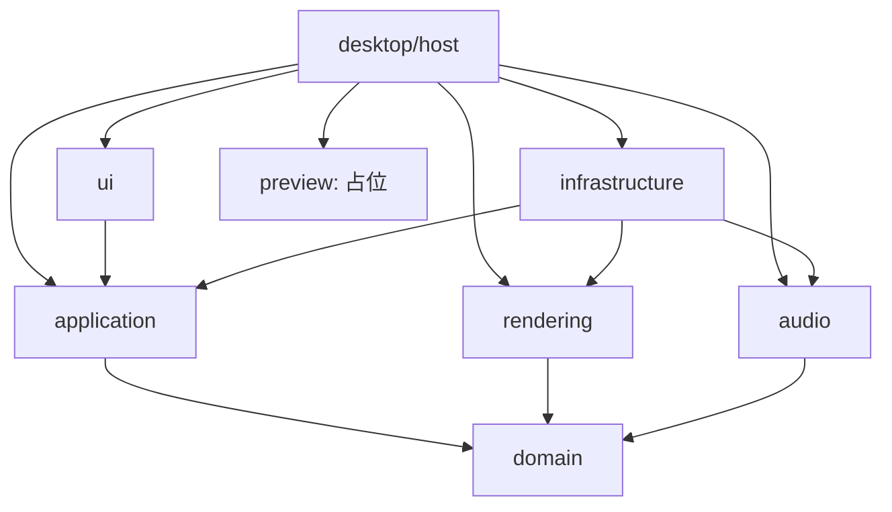
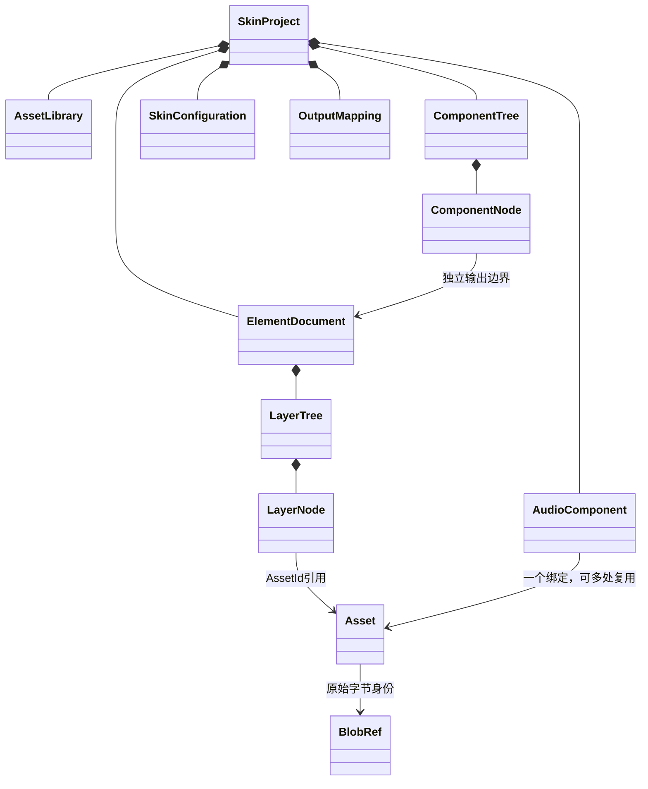

# 系统结构、对象与调用关系

2026-10-30审查快照。以下只把已存在代码作为当前实现；完整声明、字段、方法签名、trait及已解析正／反向类型引用见[八包清单](README.md#全量代码清单)。调用链是关键路径核对，不是动态派发的完备调用图。

## 总体判断

实际Cargo图仍为单向无环的模块化单体，application保留私有活动项目和唯一发布路径。没有发现UI持有可变SkinProject、preview保存项目或核心依赖GPU／设备／P0的现行边。当前图与原先包含未来模块的设计图已分开；兼容、设置存储、真实谱面和AI传输尚未冒充已有包。

需要共同审查的主要债务是身份／回执的长会话策略、持久／临时组件、导出与能力限制，以及宿主诊断职责，而非已发现的逆向依赖。边界检查不等于所有并发和行为均被形式证明，详见[置信边界](README.md#置信边界)。

## 实际静态依赖

domain／application为根纯核心工作区；桌面六包在另一工作区中复用同一核心，仍运行于同一产品进程。实际外部边：ui→egui，rendering→wgpu，infrastructure→image／sha2／CPAL／rtrb，host→eframe／pollster／getrandom及可选诊断。metadata和检查规则对应[主架构](../ARCHITECTURE.md)，不是仅靠目录命名隔离。

## 1. 项目与领域对象

原始字节由适配器存储，domain只含值与引用；上图是持有／引用，**不是继承**。普通图层组与跨文档组件是两棵不同树，音效不进入视觉树。

| 对象 | 持有／职责与关系 | 主要自有方法（完整签名见包清单） |
| --- | --- | --- |
| `SkinProject` [源码:71](../../crates/domain/src/project.rs#L71) | 私有只读项目值；活动实例由ProjectSession持有 | `empty`、`from_definition`、`id`、`model_version`、`assets`、`document`、`documents`、`components`、`audio_component`、`audio_components`、`configuration`、`outputs`；其余见全表 |
| `ProjectDefinition` [源码:14](../../crates/domain/src/project.rs#L14) | 受验证构造／转换用的自有定义，不是活动项目写入口 | `upgrade_v1`、`empty` |
| `AssetLibrary` [源码:79](../../crates/domain/src/assets.rs#L79) | 管理Asset元数据，原始字节在BlobStore | `new`、`get`、`iter` |
| `Asset` [源码:36](../../crates/domain/src/assets.rs#L36) | AssetId／名称／BlobRef／AssetKind；不等于图层实例 | `new`、`id`、`name`、`blob`、`kind` |
| `BlobRef` [源码:7](../../crates/domain/src/assets.rs#L7) | 摘要＋长度，按内容指向原始字节，不是文件路径 | `new`、`sha256`、`byte_len` |
| `ElementDocument` [源码:114](../../crates/domain/src/layers.rs#L114) | DocumentId、画布、可见性及LayerTree，保留独立输出 | `new`、`with_visibility`、`visible`、`id`、`canvas`、`layers` |
| `LayerTree` [源码:44](../../crates/domain/src/layers.rs#L44) | 普通层／可嵌套组、根／父子、变换与可见性查询 | `new`、`roots`、`node`、`parent`、`world_transform`、`iter` |
| `LayerNode` [源码:20](../../crates/domain/src/layers.rs#L20) | LayerId／LayerKind、局部变换／透明度／可见性；图片层引用AssetId | `children` |
| `ComponentTree` [源码:37](../../crates/domain/src/components.rs#L37) | 跨文档层级；成员文档与映射独立于单文档层树 | `new`、`roots`、`node`、`parent`、`world_transform`、`member`、`document_content_transform`、`iter` |
| `ComponentNode` [源码:21](../../crates/domain/src/components.rs#L21) | ComponentKind::Group或Element(document／mapping)，可整体变换 | `children` |
| `AudioComponent` [源码:60](../../crates/domain/src/audio.rs#L60) | 用途键、一个Asset引用、增益／可见性；不继承图片属性 | `new`、`with_properties`、`id`、`slot`、`asset`、`gain`、`visible` |
| `SkinConfiguration` [源码:60](../../crates/domain/src/configuration.rs#L60) | 有序原始记录，未知内容保留；不是完整skin.ini解释器 | `new`、`records`、`to_bytes` |
| `OutputMapping` [源码:54](../../crates/domain/src/output.rs#L54) | Image／Audio源及输出路径；全局冲突校验 | `new`、`id`、`document`、`for_audio`、`source`、`element_key`、`path` |
| `Affine2` [源码:51](../../crates/domain/src/geometry.rs#L51) | 仿射组合／求逆，层、组件、视口的明确空间映射 | `new`、`coefficients`、`compose`、`inverse`、`rebased`、`point` |
| `Bounds` [源码:116](../../crates/domain/src/geometry.rs#L116) | 几何包围框，不等同游戏判定区 | `transformed`、`union`、`min`、`max` |

## 2. 应用、命令、草稿与历史

ProjectSession拥有SkinProject、History、回执表、身份准入集合、原始资源固定租约及至多一个Draft。Snapshot是脱离副本，返回引用值不授予内部写权。历史恢复应用私有补丁，不重放外部I/O；取消／失败不发布半个项目。

| 对象 | 持有／职责与关系 | 主要自有方法（完整签名见包清单） |
| --- | --- | --- |
| `ProjectSession` [源码:137](../../crates/application/src/lib.rs#L137) | 唯一活动写入者；UI／导入／AI适配器只提交值请求 | `skin_audio_source`、`control_audio`、`synchronize_audio`、`draft_info`、`expected_draft`、`draft_snapshot`、`edit_draft`、`draft_once`、`navigate`、`navigation_target`、`navigate_once`、`history_scope`；其余见全表 |
| `Command` [源码:64](../../crates/application/src/contract.rs#L64) | 封闭命令枚举；图像／组／音效／资源／配置／输出 | 值／声明，字段见全表 |
| `CommandRequest` [源码:177](../../crates/application/src/contract.rs#L177) | API版本、会话、RequestId、ExpectedState和有序命令批次 | 值／声明，字段见全表 |
| `ExpectedState` [源码:55](../../crates/application/src/contract.rs#L55) | head＋revision；同节点也不代替修订冲突检查 | 值／声明，字段见全表 |
| `SessionLimits` [源码:95](../../crates/application/src/lib.rs#L95) | 命令数、回执数、历史节点数保护，不是无限会话或全部内存预算 | 值／声明，字段见全表 |
| `DraftState` [源码:21](../../crates/application/src/draft_contract.rs#L21) | DraftId／草稿revision／基础状态，不是历史节点 | 值／声明，字段见全表 |
| `HistoryRequest` [源码:332](../../crates/application/src/contract.rs#L332) | Undo／Redo／Checkout与共享去重／冲突协议 | 值／声明，字段见全表 |
| `History` [源码:203](../../crates/application/src/history.rs#L203) | 内部节点／补丁／坐标索引；只由会话使用 | `new`、`plan_append`、`append`、`summary`、`node`、`parent`、`entry`、`materialize`、`transition` |
| `HistorySummary` [源码:388](../../crates/application/src/contract.rs#L388) | 有界查询返回的节点摘要，不隐式带整树／补丁 | 值／声明，字段见全表 |
| `NodeId` [源码:41](../../crates/application/src/contract.rs#L41) | 会话内非零u64，n短地址≤14字符 | `short_address`、`parse_address`、`new`、`get` |
| `HistorySessionId` [源码:12](../../crates/application/src/contract.rs#L12) | 与ProjectId分开，跨会话不能只靠裸NodeId | `new`、`get` |
| `BranchCoordinate` [源码:291](../../crates/application/src/contract.rs#L291) | 两个有界数，b坐标≤28字符；不是祖先地址字符串 | `short_address`、`parse_address`、`new`、`branch`、`ordinal` |

入口主链：`EditorUi::submit`→`ProjectSession::submit`→私有候选执行／领域校验→补丁与资源准备→一次发布；草稿走`edit_draft`，Commit复用发布。`navigate`校验来源、恢复目的状态及资源后才换头；成功Undo记住分叉子节点，普通Redo沿记忆返回，Checkout重置记忆。

当前一个活动head／一个Draft；可以保留多个分支、查询非活动快照，不能把它描述为已有多个并行写工作区。资源只在历史不可再达且无其他租约时才可能回收；当前没有历史裁剪／磁盘历史接口。

## 3. 端口、实现与“继承”

Rust没有类继承。唯一此处相关的supertrait是`AudioEditorPort: SkinAudioPort`；`BlobLease: Send + Sync`和`ReadSeek: Read + Seek + Send`是约束组合，不是复制父对象状态。derive／自动trait也不是产品类层次。

| 契约定义 | 实现体 | 关系与作用 |
| --- | --- | --- |
| application::ResourceStore | infrastructure::BlobStore／Images；core::NoResources | pin已准备的不可变字节，查询已验证元数据；不授予项目写权 |
| application::BlobLease | infrastructure::blobs::Entry及测试fake | Send＋Sync不可变租约，存活期间阻止回收 |
| application::RasterImportPort | infrastructure::Images | 显式路径准备PNG；成功登记仍走Command |
| application::PreviewPort | host::NativeHost | 接只读项目和FrameSource，返回描述符 |
| ui::Presenter | host::NativeHost | egui呈现FrameKey，不暴露可变渲染器 |
| application::SkinAudioPort | host::EditorAudio／infrastructure::AudioSupplyClient／SkinAudioController／DisabledAudio | 同步只读来源及取消事实；宿主／适配器分层 |
| application::AudioEditorPort | host::EditorAudio／DisabledAudio；诊断Shared与测试fake | 设备／试听／监听请求及有界状态观察 |
| infrastructure::AudioDecoder | WavDecoder及受控fake | probe／decode；解码worker不持有会话 |
| eframe::App | host::Editor及各显式验证Run | 框架生命周期，不是业务继承 |
| egui_wgpu::CallbackTrait | host::Draw及诊断Marker／Inject | 提交／绘制回执及GPU租约 |

具体完整签名和实现来源在各包清单；测试／诊断实现不冒充第二套产品接口。

## 4. 图像／GPU对象与数据流

| 对象 | 持有／职责与关系 | 主要自有方法（完整签名见包清单） |
| --- | --- | --- |
| `Plan` [源码:44](../../desktop/rendering/src/lib.rs#L44) | 从只读项目构建操作，CPU／GPU共用语义；当前上限不是stable规则 | `build`、`document`、`sources` |
| `Raster` [源码:20](../../desktop/rendering/src/lib.rs#L20) | 尺寸与受管RasterPixels，源图可共享 | 值／声明，字段见全表 |
| `RasterPixels` [源码:12](../../desktop/rendering/src/pixels.rs#L12) | 共同持有字节与驻留租约，不能拆走最后像素绕过预算 | `with_residency`、`is_shared` |
| `GpuComposer` [源码:32](../../desktop/rendering/src/gpu.rs#L32) | 设备／管线／源图缓存／目标合成所有者 | `new`、`with_upload`、`staging_usage`、`clear_sources`、`source_usage`、`source_allocations`、`source_buffer`、`render` |
| `GpuPreparation` [源码:10](../../desktop/rendering/src/gpu.rs#L10) | 在途GPU准备与完成点 | 值／声明，字段见全表 |
| `ReusableUpload` [源码:120](../../desktop/rendering/src/upload.rs#L120) | 显式候选的有界暂存复用，非当前普通默认 | `usage`、`clear`、`write` |

| 对象 | 持有／职责与关系 | 主要自有方法（完整签名见包清单） |
| --- | --- | --- |
| `NativeHost` [源码:60](../../desktop/host/src/presentation.rs#L60) | 实现PreviewPort和Presenter；创建／注册纹理，来源匹配、poll及退休 | `bind_loss`、`with_upload`、`enable_trace`、`retire`、`wait_preparation`、`poll`、`poll_live`、`loss_signal`、`is_lost`、`invalidate_source`、`clean_lost_device`、`into_rebuild_seed`；其余见全表 |
| `FrameWorker` [源码:35](../../desktop/host/src/frame_worker.rs#L35) | 有界后台准备与完成；不拥有活动项目写权 | `new`、`current`、`cancel`、`try_close`、`submit`、`poll`、`wait`、`close`、`closed` |
| `ImportWorker` [源码:9](../../desktop/host/src/import_worker.rs#L9) | 图像／音频显式导入准备；不得越过Command登记 | `new`、`enqueue`、`enqueue_request`、`drain`、`close`、`closed` |
| `Draw` [源码:688](../../desktop/host/src/presentation.rs#L688) | 保留待提交的绘制／GPU资源，不把TextureId视作所有权 | 值／声明，字段见全表 |
| `RebuildSeed` [源码:90](../../desktop/host/src/presentation.rs#L90) | 显式恢复入口的无GPU交接，携带同一会话而非复制项目 | `build`、`build_retained` |

图像导入先暂存／校验与资源准入，`host::import`经UI的提交动作登记Asset；“加入当前元素”是另一个命令行为。当前没有在线提供方或下载器。

预览：`ProjectSession::request_preview`→`NativeHost`→`FrameWorker`／`Plan`／`GpuComposer`→候选完成与完整来源校验→Presenter／Draw→真实提交完成后回收。FrameKey是宿主游标；FrameSource含会话、活动修订／节点、草稿、目标、场景、模拟时间、尺寸与视口代次。历史、取消、resize／DPI及设备变化均不能仅按文件名或旧NodeId接纳结果。

不同坐标链为：节点局部→父／组件→文档／工作区→视口GUI点→物理像素。当前工作区512²是占位布局；游戏对象／实例／判定区映射尚未建立，不能推断现有X／Y可直接迁入stable。

## 5. 音频／资源对象与数据流

| 对象 | 持有／职责与关系 | 主要自有方法（完整签名见包清单） |
| --- | --- | --- |
| `SoundPlan` [源码:34](../../desktop/audio/src/lib.rs#L34) | 组件或原始素材目标及配方；字节透传／编辑／静音语义与Voice分开 | `build`、`output_action`、`original_bytes`、`process_pcm` |
| `Origin` [源码:14](../../desktop/audio/src/runtime.rs#L14) | 会话／节点／修订／导航／草稿来源，不用声音文件名代替身份 | 值／声明，字段见全表 |
| `Runtime` [源码:279](../../desktop/audio/src/runtime.rs#L279) | 有界绑定、事件、双通道Voice、候选激活与旧来源清理 | `new`、`pcm_budget`、`with_budget`、`enable_minimum_conversion`、`output_activity`、`output_format`、`synchronize`、`synchronize_cancelled`、`request_library`、`library_sound`、`library_status`、`fail_library`；其余见全表 |
| `PcmBudget` [源码:26](../../desktop/audio/src/pcm.rs#L26) | 共享预留及实际分配计费，克隆只计一次 | `new`、`reserve`、`usage`、`same_pool` |
| `PcmReservation` [源码:74](../../desktop/audio/src/pcm.rs#L74) | 解码前取得额度，失败／取消按真实释放退还 | `allocate` |
| `PcmBuffer` [源码:101](../../desktop/audio/src/pcm.rs#L101) | 不可变样本及内嵌配额租约，原始字节另有租约 | `samples`、`samples_mut`、`budget`、`same_allocation`、`downgrade` |
| `PreparedSound` [源码:94](../../desktop/audio/src/runtime.rs#L94) | 已准备中性PCM与来源／配方，不是最终导出文件 | `from_source`、`from_decoded`、`samples`、`pcm`、`monitor_gain`、`format`、`cache_key`、`downgrade`、`add_monitor_frames`、`add_monitor_frames_with_gain`、`monitor_finished`、`monitor_frame`；其余见全表 |
| `VoiceValidity` [源码:182](../../desktop/audio/src/voice.rs#L182) | 有界失效／增益控制；回调观察不表示声学静音 | `new`、`revoke`、`set_gain`、`is_valid`、`gain` |

| 对象 | 持有／职责与关系 | 主要自有方法（完整签名见包清单） |
| --- | --- | --- |
| `BlobStore` [源码:67](../../desktop/infrastructure/src/blobs.rs#L67) | 跨媒体原始字节摘要／长度去重，历史以BlobLease固定 | `stage_audio`、`stage_wav`、`observe_bytes`、`stage_original_file`、`with_limits`、`get`、`usage`、`insert`、`stage_bytes`、`stage_reader` |
| `Images` [源码:56](../../desktop/infrastructure/src/lib.rs#L56) | RGBA派生缓存和图片准备，原始字节与RGBA分别计费 | `observe_rgba`、`with_store`、`blobs`、`prune`、`raster`、`rgba_bytes`、`rgba_peak_bytes`、`load_raster`、`reserve_pixels`、`stage_bytes`、`prepare`、`sample_png` |
| `AudioPreparationQueue` [源码:173](../../desktop/infrastructure/src/audio_preparation.rs#L173) | 四个排队加一个活动的有界准备，迟到结果重查 | `new`、`prune`、`usage`、`submit`、`start_next`、`finish`、`cancel_component`、`cancel_target`、`cancel_library`、`cancel_outdated`、`close` |
| `RunningPreparation` [源码:77](../../desktop/infrastructure/src/audio_preparation.rs#L77) | 活动工作单元与取消标志，取消后等真实释放 | `request`、`execute` |
| `PreparationWorker` [源码:6](../../desktop/infrastructure/src/audio_worker.rs#L6) | 单后台解码worker，有界工作／结果交接 | `new`、`try_submit`、`try_result`、`wait_result`、`close`、`closed` |
| `WavDecoder` [源码:7](../../desktop/infrastructure/src/wav.rs#L7) | 产品当前PCM16 WAV探测／解码，不代表完整stable音频覆盖 | 值／声明，字段见全表 |
| `SkinAudioController` [源码:14](../../desktop/infrastructure/src/skin_audio.rs#L14) | 准备控制与只读项目来源适配，执行SoundPlan及候选校验 | `new`、`with_budget`、`runtime`、`output_invalidation`、`take_builds`、`admit_builds`、`admit_selected`、`request_library`、`cancel_library`、`start_preparation`、`retry_preparation`、`retry_selected`；其余见全表 |
| `AudioSupplyClient` [源码:136](../../desktop/infrastructure/src/audio_supply.rs#L136) | 主线程读取实际来源，再投递脱离投影；不是项目共享可变指针 | `diagnostic_recovery_probe`、`barrier`、`spawn`、`spawn_separated`、`spawn_streamed`、`spawn_owned`、`reserve`、`send`、`synchronize`、`set_background`、`scene_running`、`seek_background`；其余见全表 |
| `SupplyReceipt` [源码:64](../../desktop/infrastructure/src/audio_supply.rs#L64) | 共享控制额度及被保留来源，消费／释放而非清队列即退款 | 值／声明，字段见全表 |
| `NativeExecutor` [源码:288](../../desktop/infrastructure/src/separated_native.rs#L288) | 当前Windows分离输出的CPAL执行／端点归还 | `controlled_return`、`fault_signal`、`capture_work_cost`、`work_cost`、`period_frames`、`play`、`stats`、`next_first`、`take_first_observer`、`set_monitor_volume`、`try_stop`、`stop` |
| `OutputConsumer` [源码:285](../../desktop/infrastructure/src/native_audio.rs#L285) | 原预混输出消费者，仍有诊断／平台预留用途，不直接移走 | `render`、`render_f32` |
| `VoiceOwner` [源码:84](../../desktop/infrastructure/src/voice_handoff.rs#L84) | 固定就绪声音／租约；退休及最后所有权释放在回调外 | `retained_drafts`、`token`、`outstanding`、`admit`、`publish`、`pump_runtime`、`update`、`set_scene_running`、`stop_audition`、`invalidate_source`、`close`、`collect`；其余见全表 |
| `VoiceConsumer` [源码:95](../../desktop/infrastructure/src/voice_handoff.rs#L95) | 回调有界消费／失效与退休，不调用项目或解码器 | `format`、`stop`、`drain_pending`、`return_packet`、`retire_slot`、`retire_all`、`flush_deferred`、`render_split`、`render_inner`、`render_to`、`render_committed` |

当前Windows主链：UI音效动作→`ProjectSession::control_audio`／`synchronize_audio`→EditorAudio→AudioSupplyClient→供给所有者／SkinAudioController→PreparationWorker／WavDecoder→准备结果核验→Runtime／分离输出→CPAL回调。图像的可见性／变换不会驱动声音绑定。

原始素材试听与组件试听共享资源预算；场景冻结与显式试听分别门控。重绑定／隐藏／删除截断旧组件试听，新素材不自动播放；同源增益可保留已有试听位置并实时调整，Esc恢复原增益。草稿内新触发声音、历史、停止或设备变化不适用该连续例外。

皮肤版本和背景时间线独立；BackgroundInput／BufferedBackground仅在有背景来源时读取，普通GUI没有真实歌曲。生成前沿、回调复制锚点和设备消费位置不同；暂停／定位先作废旧代次，不补跑冻结期间事件。

## 6. UI／预览与线程所有权

| 对象 | 持有／职责与关系 | 主要自有方法（完整签名见包清单） |
| --- | --- | --- |
| `EditorUi` [源码:45](../../desktop/ui/src/lib.rs#L45) | 持选择、面板、手势、快捷键及内存设置；只通过应用请求写项目 | `scene_is_frozen`、`open_audio_editor`、`set_audio_port`、`synchronize_audio`、`refresh_audio`、`audio_needs_poll`、`audio_command`、`create_audio_component`、`source_label`、`audio_panel`、`history_panel`、`selection`；其余见全表 |
| `Selection` [源码:21](../../desktop/ui/src/lib.rs#L21) | 图层(doc／layer)或持久组件身份；临时多选不入项目 | 值／声明，字段见全表 |
| `EditorAction` [源码:6](../../desktop/ui/src/shortcuts.rs#L6) | 按钮／快捷键共享动作，文本／IME优先，游戏输入隔离 | 值／声明，字段见全表 |
| `Presenter` [源码:31](../../desktop/ui/src/lib.rs#L31) | UI自定义的窄呈现端口，NativeHost实现 | `current`、`paint`、`thumbnail` |

| 对象 | 持有／职责与关系 | 主要自有方法（完整签名见包清单） |
| --- | --- | --- |
| `PreviewState` [源码:9](../../desktop/preview/src/lib.rs#L9) | 当前只有占位时钟、场景、冻结、自动／全屏标记与输入计数 | `advance`、`input`、`micros`、`accepted_inputs` |
| `Scene` [源码:4](../../desktop/preview/src/lib.rs#L4) | Canvas／Playground占位，不是完整stable场景集合 | 值／声明，字段见全表 |

| 所有者 | 当前工作 | 不可承担的职责 |
| --- | --- | --- |
| GUI／Editor | 活动ProjectSession、UI、宿主控制、帧来源和错误处理 | 设备回调不能回访该会话 |
| ImportWorker | 明确路径I/O／字节准备，图像和音频共用入口 | 不登记项目或历史 |
| FrameWorker | 脱离／只读的图像准备与有界结果 | 不替换活动SkinProject |
| 音频供给所有者 | 接控制、Runtime、准备准入、背景及声音供给 | 不依赖GUI帧率，不持有ProjectSession |
| PreparationWorker | 单工作单元probe／decode | 不接纳过期来源，不退款尚未释放额度 |
| 可选背景读取器 | 有界后台读取／定位／归还 | 不让回调做阻塞I/O |
| 原生回调 | 固定数据消费、混音／复制、代次与确认 | 不分配／等待／解码／最后释放PCM，不冒充设备消费 |

默认不启用音频设备；线程／队列／缓存并非全部从应用启动就存在。状态观察及诊断另有有界记录，不进入项目历史。普通图形故障只冻结／诊断，完整保留项目后窗口重开仍仅是验证入口。

## 7. 身份与版本对照

| 身份／版本 | 含义 | 不能混用 |
| --- | --- | --- |
| ProjectId | 项目身份；当前空项目宿主仍固定1，持久化前须定案 | 不是HistorySessionId |
| Asset／Document／Layer／Component／AudioComponent／Output ID | 不同类型的项目对象候选 | 不用名称、路径或渲染句柄代替 |
| BlobRef | 原始字节摘要／长度 | 不等于AssetId或派生PCM |
| NodeId＋HistorySessionId | 会话限定历史身份；短地址辅助寻址 | 不等于revision、文件永久书签 |
| DraftState | 单次交互候选及基础修订 | 不等于已提交节点 |
| FrameKey／FrameSource | 显示游标与完整来源 | 不等于TextureId或GPU租约 |
| Origin／VoiceRuntimeKey／设备代次 | 声音来源、实例、后端有效性 | 不等于游戏对象或文件名 |
| 模型2／应用6／预览2／声音来源1／音效编辑3／SoundPlan2／监听转换1 | 各自进程内语义版本 | 没有因此生成文件schema或外部序列化协议 |

## 8. 检查、覆盖与待审查项

根边界守护两个无第三方核心包；桌面守护精确包／版本／feature方向和源码边界，CI及hook复用正式入口。检查是明确规则＋编译／行为回归，不是Rust能力沙箱。C／ETW只用于外部诊断，P0独立实验及其自制fixture保留原路径，均未引入产品图。

所有源码的符号位置可由[源码索引](catalog/SOURCE_FILES.md)复核。诊断入口规模、固定回执上限、ID分配、短地址重开及新文件阶段的风险见[待讨论决定](DECISIONS.md)；这些不是本轮已经改掉的行为。下一步先共同审查，不启动P3。
